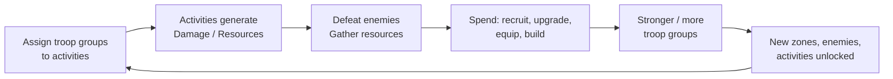
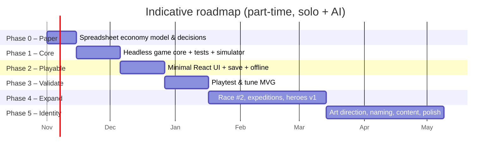

# FANTASY IDLE RPG — Concept & Architecture v0.1

> **Status:** Discovery / planning. No code has been written.
> **Working title:** *Fantasy Idle Army RPG* (final name and IP still to be decided)
> **Date:** 2026-10-22

**Labels used throughout:**

| Label | Meaning |
|---|---|
| ✅ **Confirmed** | Already decided in the project brief |
| 💡 **Proposed** | My recommendation. Open to challenge, not a commitment |
| ❓ **Open** | Needs a decision before (or during) development |

---

## Table of Contents

0. [Executive Summary](#0-executive-summary)
- A. [Game Vision](#a-game-vision)
- B. [Core Gameplay Loop](#b-core-gameplay-loop)
- C. [Race System](#c-race-system)
- D. [Troop System](#d-troop-system-the-heart-of-the-game)
- E. [Combat & Resource Systems](#e-combat--resource-systems)
- F. [Idle & Offline Progression](#f-idle--offline-progression)
- G. [Technical Architecture](#g-technical-architecture)
- H. [Minimum Viable Game](#h-minimum-viable-game-mvg)
- I. [Long-Term Expansion](#i-long-term-expansion)
- J. [Risks & Mitigations](#j-risks--mitigations)
- K. [Development Roadmap](#k-development-roadmap)
- L. [Top 5 Recommendations & 3 Questions to Resolve](#l-top-5-recommendations--3-questions-to-resolve)

---

## 0. Executive Summary

The concept is a **fantasy idle game where your army is your economy**. Every troop group is a scarce unit of labour that can fight, mine, log or explore, and the central skill is deciding *where your limited forces are most valuable right now*.

That allocation decision is the game's strongest and most distinctive idea, and it is also its main design risk. It is only interesting if no single assignment is always correct. Most of this document is about making that decision stay interesting: combat and economy that depend on each other, troop types with affinities, enemies that call for specific counters, and goals that change over time.

**Key positions in this document:**

1. **The game is an allocation puzzle, not a number-watching game.** Everything in it (races, heroes, upgrades) should make the question "where do my troops go?" harder or more interesting.
2. **Troops should be hybrids, not hard-split workers and soldiers.** Any group can do any activity, but troop *types* have strong affinities, and moving a group costs travel time.
3. **Heroes, multiple races, territories and online features are kept out of the first playable version.** They multiply the core loop. They cannot fix a weak one.
4. **React + TypeScript + Vite + PWA is a good fit**, because an idle game is mostly interface rather than real-time rendering. It should sit on top of a **pure TypeScript game core** with no UI dependencies, plus a **headless balance simulator**. The simulator is the single most valuable tool for a solo developer.
5. **The first playable build should be about 60–90 minutes of content with one race**, made to answer one question: *"Do I voluntarily reassign my troops, and do I want to come back?"*

---

## A. Game Vision

### A.1 Elevator pitch 💡

> *Lead a small band of your people out of a ruined age. Every soldier is precious: send them to hold the line against the darkness, to dig iron from the mountains, or to fell timber for the walls. Your army grows while you're away. Your choices decide what it becomes.*

### A.2 Core identity 💡

| Pillar | What it means | What it rules out |
|---|---|---|
| **1. Every troop matters** | Troop groups are few, named, persistent and valuable. Unlocking a new group is a major event. | Thousands of anonymous units and pure "+1 soldier" clicker inflation |
| **2. War and economy are one system** | Fighting opens access to resources, and resources power the fighting. Neither can be ignored. | A combat tab and a separate gathering tab that never interact |
| **3. Decisions over reflexes** | The player's skill is planning and allocation. Nothing depends on fast reactions. | Action combat, manual tapping as the main mechanic |
| **4. A world that remembers** | Atmosphere comes from writing, illustration and a progression through places, not from animation. | Expensive 3D, animation-dependent feedback |
| **5. Respectful idle** | Short, meaningful check-ins. Being away is rewarded, not punished. | Punishing timers, energy systems, predatory monetisation |

### A.3 What could make it distinctive

Most idle RPGs fall into one of two groups:

- **Hero/party idlers** (AFK Arena-style): progression comes from collecting and levelling characters. The decisions are mostly about team composition, and many games in this group are gacha-driven.
- **Economy idlers** (Cookie Clicker, Antimatter Dimensions): the decisions are about buy order and timing, with very little fantasy.

**The gap:** a game where **your soldiers *are* your workforce**, and so the tension between war and economy is physical. Every group you send to the mine is a group that isn't holding the line. Few idle games make that trade-off central. Games like *Melvor Idle* (skills compete for a single "action" slot) and *Kittens Game* (worker allocation) show that allocation-based idle design can sustain long-term play. This concept adds a fantasy army framing and a combat layer on top of it.

### A.4 Tone and visual direction ✅ / 💡

- ✅ Serious, atmospheric dark/epic fantasy. Original IP inspired by Tolkien-style worldbuilding, not copied from it.
- 💡 **"Illuminated war ledger" aesthetic:** the interface feels like a commander's table, with parchment and leather panels, ink-drawn maps, portrait cards and wax-seal buttons. This works well with static art and looks the same on mobile and desktop.
- 💡 Feedback comes from *UI motion* (number tick-ups, bar fills, card flips, screen-edge flashes on a boss kill). It needs no character animation.
- 💡 **IP caution:** avoid names, races and visual elements that are too close to Tolkien (e.g. "Uruk", "Mordor-like" volcano lords, "Rangers of the North"). Plan to give the four races original names and cultural twists early, because renaming late is expensive.

---

## B. Core Gameplay Loop

### B.1 The loops



| Loop | Time scale | Player action | Reward |
|---|---|---|---|
| **Micro** | Seconds–minutes (active play) | Watch an enemy fall, buy an upgrade, reassign one group | Immediate number growth |
| **Session** | 2–10 minutes per check-in | Collect offline gains, rebalance assignments, push the next boss, queue upgrades | Visible jump in power, new enemy or zone |
| **Mid-term** | Hours–days | Unlock a new troop group or troop type, clear a region | New strategic options |
| **Long-term** | Weeks | New regions/acts, heroes, (later) prestige or campaign resets | New systems |

### B.2 The tension that drives the decisions 💡

The loop only produces decisions if the two sides **depend on each other**:

```
          ┌────────────── needs iron/wood for weapons & recruits ───────────┐
          ▼                                                                  │
   ┌─────────────┐                                                   ┌──────────────┐
   │   COMBAT    │── clears zones → unlocks new mines/forests/loot ─▶│   ECONOMY    │
   │ (damage,    │                                                   │ (iron, wood, │
   │  bosses)    │◀─── gold & trophies from kills fund recruitment ──│  supplies)   │
   └─────────────┘                                                   └──────────────┘
```

- If combat alone is enough → nobody gathers resources. ❌
- If gathering alone is enough → nobody fights. ❌
- **Goal:** the best allocation *changes over time*. Before a boss, you shift groups to combat. After an upgrade tier opens, you shift them to the mines.

### B.3 How the first stages might feel 💡 (illustrative, not final)

#### First 10 minutes: "One band, one choice"

| Min | What happens | Decision the player makes |
|---|---|---|
| 0–1 | Pick a race. Short intro (3 text panels with an illustration). You command **one troop group** (e.g. 10 Militia) camped at the edge of a ruined borderland. | Race |
| 1–3 | The group fights wolves/bandits automatically. Gold trickles in. The first upgrades (sharpen blades, drill) are affordable. | Which upgrade first |
| 3–5 | **The first real choice:** a wooden palisade upgrade (+defence, required for the first boss) costs **wood**. You can only get wood by **taking your only group off combat**. | Fight vs gather |
| 5–8 | You log wood, build, return to combat, and beat the first boss (a bandit chieftain). | Timing |
| 8–10 | The boss kill unlocks the **2nd troop group** and an **Iron Mine** activity. Now you have two groups and three activities. | First real allocation |

The goal for minute 10: the player has *felt* scarcity and then *felt* relief when it was lifted.

#### First hour: "Specialisation emerges"

- 2–3 troop groups. The first **troop type choice**: train a new group as *Spearmen* (combat), *Miners/Sappers* (mining affinity) or *Woodsmen* (wood and scouting).
- Enemies start to have **traits** (armoured, swift, swarm). Your best combat group may not be the right one for this zone.
- The first **offline session**: you close the game, come back 30–60 minutes later, and see a summary ("Your forces slew 312 bandits and gathered 840 iron").
- You reach Region 2 (mountains/mine theme). Mining output now gates armour upgrades.

#### Later stages (days–weeks)

- 5–8 troop groups, several troop types, veterancy levels.
- **Heroes** take command of groups and change what each group is good at.
- **Expeditions** (send a group away for 2–8 hours for rare materials) add a "come back later" rhythm.
- **Regions / territories:** holding a region gives passive income but needs a garrison. Allocation now has a defensive side too.
- Possible **prestige layer** (❓ see §L): "a new age begins". You keep legacy bonuses and replay faster with new options.

---

## C. Race System

### C.1 Design principle 💡

> **Races change *how* you play the same systems. They never add a different set of systems.**

Each race is a **data file**: a set of modifiers, a troop roster and *at most one* signature mechanic built from shared building blocks. No race-specific `if (race === 'orc')` code paths.

### C.2 Three layers of asymmetry

| Layer | Cost to build | Gameplay impact | When |
|---|---|---|---|
| **1. Stat modifiers** (+20% mining, −10% recruit cost) | Very low (data only) | Low–medium: changes efficiency, not decisions | MVP+ |
| **2. Troop roster** (different troop types with different affinities) | Low–medium (data + art) | **High:** changes which allocations are good | v0.2+ |
| **3. Signature mechanic** (one unique rule per race, built from shared systems) | Medium | High: changes the play pattern | v0.3+ |

Stat modifiers alone (layer 1) are the most common reason race choice feels cosmetic. The **roster** layer is where real identity lives.

### C.3 Illustrative race sketches 💡 (examples only, nothing is final)

| Race | Fantasy | Modifier flavour | Roster tendency | Signature mechanic idea (shared-system based) |
|---|---|---|---|---|
| **Humans** | Adaptable kingdoms | Cheaper recruitment, faster reassignment | Balanced, versatile troops | **Levy:** can field one extra temporary group (uses the existing troop-group system with an expiry timer) |
| **Dwarves** | Mountain holds | +Mining, +Defence, slower recruitment | Heavy, slow, durable; strong miners | **Deep Veins:** mines grow richer the longer the same group works them (uses activity *veterancy*) |
| **Elves** | Ancient forests | +Wood/herbs, +Ranged damage, small groups | Elite, few, expensive | **Scouting:** reveals enemy traits and loot before you commit (uses the *information/scouting* system) |
| **Orcs** | Warbands | +Combat, raids yield resources, weak gathering | Many cheap troops | **Raiding:** combat kills drop iron/wood directly (uses the *loot table* system), so fighting replaces gathering, at a cost in upkeep |

**Critique of the original sketch:** "Humans = balanced" is a common trap. *Balanced* can easily mean *bland*. Give Humans an active identity (flexibility: cheap, fast reassignment) rather than "slightly OK at everything".

### C.4 Balancing approach 💡

- **One baseline race (Humans) is built and tuned first.** Every other race is defined as a *delta* from that baseline.
- Each race should reach the same milestone (e.g. boss of Region 3) within roughly **±15% of the baseline time** when played well. The balance simulator (§G) checks this automatically.
- Accept that races will be *different*, not *equal*. That is fine in a single-player game. Exact balance only becomes critical if PvP or leaderboards ever exist.

### C.5 Open questions ❓

- Is race choice **permanent** for a save, or can the player start or keep several realms? (Recommendation: one race per save, multiple save slots later. A prestige reset could allow switching.)
- Could the player eventually **recruit troops from other races** (e.g. allied Elven archers in a Human army)? It is attractive, but it dilutes race identity. Postpone.

---

## D. Troop System (the heart of the game)

### D.1 Terminology 💡

| Term | Definition |
|---|---|
| **Troop Type** | A template: Militia, Spearmen, Miners, Archers… Defines base stats and **activity affinities**. Data-driven. |
| **Troop Group** | A persistent unit the player owns: a type, a **size** (number of soldiers), a **veterancy level** and a current **assignment**. *This is what the player allocates.* |
| **Group Slot** | The capacity to field a group. **Slots are the scarcest resource in the game.** |
| **Activity** | Something a group can be assigned to: Fight (in a zone), Mine, Log, Scout, Expedition… Data-driven. |
| **Assignment** | A group → activity link, plus the state of that link (marching, active). |

### D.2 The key question: switching model

The brief leaves this open. Here are the four realistic options:

| Model | Description | Pros | Cons |
|---|---|---|---|
| **A. Free switching** | Any group, any activity, switch instantly | Simplest; maximum flexibility | **The decision is trivial**: you just switch whenever. No commitment, no planning. Also encourages micro-management while active. |
| **B. Dedicated roles** | Workers gather, soldiers fight; never interchangeable | Clear; easy to balance | **Removes the core tension.** It becomes two separate idle games. The "every soldier is precious" fantasy is lost. |
| **C. Hybrid: affinity + switching cost** 💡 | Any group can do anything, but types have efficiency multipliers (e.g. Miners 150% mining / 50% combat) and reassignment takes **march time** | Real trade-offs; specialisation *emerges*; simple to explain | Needs tuning for affinity values and march times |
| **D. Hybrid: commitment** | Groups lock into a role for a duration (e.g. 1 h), like expeditions | Strong planning element | Frustrating when you notice a mistake; feels like a timer wall |

**💡 Recommendation: Model C, with D used selectively for Expeditions only.**

- **Affinity** is what makes troop *types* matter. Without it, a group is just a number.
- **March time** (e.g. 30 s – 2 min early, longer to distant zones) is a *soft* commitment. It prevents trivial switching every few seconds, but never feels like a lock.
- **Expeditions** are the one place where hard commitment (D) appears, so that "send them away for 4 hours" stays a deliberate choice.

#### Why affinity multipliers are the key lever

```
Group effectiveness at an activity =
    group size × type base stat × type affinity[activity] × veterancy bonus × modifiers (race, upgrades, hero)
```

Example (illustrative):

| Troop Type | Fight | Mine | Log | Scout |
|---|---|---|---|---|
| Militia | 100% | 80% | 80% | 50% |
| Spearmen | 150% | 30% | 30% | 40% |
| Miners | 50% | 175% | 60% | 20% |
| Woodsmen | 70% | 50% | 160% | 120% |

With these numbers, putting Spearmen in a mine is *possible but wasteful*. The player can still do it during a resource crunch, and that is the kind of decision we want.

### D.3 Recruitment and growth 💡

Two growth axes, kept separate on purpose:

| Axis | How you get it | What it feels like | Pacing |
|---|---|---|---|
| **Group size** (more soldiers in a group) | Spend gold + supplies (iron/wood) | Gradual, frequent "+5 soldiers" purchases | Frequent (minutes) |
| **Group slots** (more groups) | **Milestones only** (boss kills, region clears, a keep upgrade) | **A major event:** new strategic options | Rare (every 15–60 min early, hours later) |

- **💡 Slots should not be purchasable with currency.** If they can be bought, the player trades a strategic unlock for grinding, and the most exciting moment in the game becomes a shop purchase.
- **Troop type** is chosen when a slot is unlocked. It could be **retrained** later for a cost and downtime. That gives a correction path without making types meaningless.
- **Veterancy:** a group gains XP from any activity, which gives a small all-round stat boost. This makes long-lived groups feel valuable ("my 1st Spearmen, level 12").
  - ❓ Alternative: *activity-specific* veterancy (a group gets better at what it keeps doing). It is more thematic, but it punishes switching and adds state. Revisit after playtesting. It could also be a Dwarf signature (see §C).

### D.4 Upkeep? ❓ (deliberately left open)

Upkeep (troops eat food) creates strong allocation pressure, because someone *must* gather food. But it has well-known problems in idle games:

- Offline starvation is a *punishment for being away*, which goes against pillar 5.
- It adds a resource that is purely a tax.

💡 If it is introduced, use **soft upkeep**: running low on food reduces efficiency (e.g. down to −30% at most) but never kills troops. Not in the MVP.

### D.5 What makes unlocking a new group exciting 💡

Each new slot should add *at least one* of these:

1. A new **troop type** to choose (a new affinity profile).
2. Access to a **new activity or zone** that the previous groups could not cover.
3. The ability to **cover two needs at once** that used to compete.

If a new slot only means "+33% output", it is a failure of the design.

---

## E. Combat & Resource Systems

### E.1 Combat model 💡: "attrition, not choreography"

Combat is a **numbers contest against a sequence of enemies in a zone**. There is no positioning and no real-time input.

```
Zone (e.g. "Ashen Borderlands", 10 stages + boss)
 └─ Stage n: enemy with HP, Armor, Trait(s)
      Groups assigned to this zone deal combined DPS
      Enemy dies → rewards → next enemy (stage counter advances after X kills)
      Boss: has a time limit (e.g. 30 s). Fail → stay farming, come back stronger.
```

**Damage formula (MVP, deliberately simple):**

```
effective DPS (per group) = size × attack × affinity[Fight] × modifiers × counterMultiplier(trait, type)
time to kill = enemy HP / Σ effective DPS
```

- **Enemy HP scales exponentially** with stage (e.g. ×1.12–1.18 per stage). This is standard in the genre and creates "walls" that upgrades and reallocation solve.
- **Boss timers** are the main "wall" mechanic. They give a concrete short-term goal and a reason to temporarily *stack all groups on combat*, which is an allocation decision.

### E.2 Do troops take damage?

| Option | Gameplay value | Cost |
|---|---|---|
| **No (pure DPS race)** 💡 MVP | Simple; clear | Defence stats are meaningless |
| **Enemy pressure → casualties** | Defence/armour matter; losses create tension and a reason to recruit | Offline casualties feel bad; more tuning |
| **Enemy pressure → morale/efficiency** | Defence matters without permanent loss | Medium complexity |

💡 **MVP: no casualties.** Revisit with the *morale* option in v0.2 if defensive troop types (Dwarves!) need a purpose. Permanent casualties offline are anti-fun.

### E.3 Enemy traits and counters 💡 (the cheapest source of real decisions)

Give enemies 1–2 **traits**. Give troop types **counter bonuses**:

| Enemy trait | Countered by | Effect |
|---|---|---|
| **Armoured** | Heavy / piercing troops (Spearmen, Dwarven axes) | Others deal −50% |
| **Swift** | Ranged / skirmishers (Archers, Woodsmen) | Others deal −40% |
| **Swarm** | Many-soldier groups (Militia, Orc mobs) | Damage scales with *size* rather than quality |

This makes zone choice and group composition matter *without* a complex combat engine. It is the main reason an idle army game feels like *strategy*.

### E.4 Resources 💡

Keep the count small. Every resource needs a clear *purpose* and a clear *source*.

| Resource | Source | Spent on | MVP? |
|---|---|---|---|
| **Gold** | Combat kills | Recruiting soldiers, general upgrades | ✅ |
| **Wood** | Logging activity | Fortifications, bows/spears, buildings | ✅ |
| **Iron** | Mining activity (unlocked by combat progress) | Weapons and armour tiers | ✅ |
| Food / Supplies | Farming/foraging | Upkeep (❓ see §D.4) | ❌ |
| Rare materials (mithril-equivalent, runes, herbs) | Expeditions, bosses | Hero gear, high-tier upgrades | ❌ |
| Trophies / Renown | Bosses, milestones | Permanent/meta unlocks, prestige | ❌ |

**Resource production formula:**

```
rate (per second) = size × gatherStat × affinity[activity] × nodeRichness × modifiers
```

- **Nodes** (e.g. "Old Copper Seam", "Blackpine Grove") are unlocked by clearing combat zones. Better nodes give higher richness.
- 💡 Optional later: nodes could have **capacity** (max N groups) or **depletion**, which pushes groups to move on. This makes distribution decisions interesting. Not in the MVP.

### E.5 Upgrades 💡

Three upgrade families. Each family should create a *choice*, not just an automatic purchase:

| Family | Example | Why it creates decisions |
|---|---|---|
| **Linear upgrades** | "Sharpened Blades I–X": +10% attack per level | Baseline progression (necessary, not interesting by itself) |
| **Branching doctrines** | Choose *Shield Wall* (defence) **or** *Spear Charge* (damage). Respec possible at a cost. | Commits the player to a style |
| **Unlocks** | "Watchtower: reveals enemy traits", "Roads: −30% march time" | Changes how the game is *played*, not just how much numbers rise |

---

## F. Idle & Offline Progression

### F.1 Core principle 💡

> **The simulation is deterministic and time-based. "Offline" is just "simulate a large Δt when the game loads."**

The same game-core function handles a 100 ms tick and an 8-hour absence. This removes a whole category of bugs where online and offline progress disagree.

### F.2 Online vs offline 💡

| Aspect | Online (game open) | Offline (game closed) |
|---|---|---|
| Combat | Kill-by-kill, visible | Computed analytically: total damage ÷ HP per enemy → kills |
| Stage advancement | Automatic after X kills | ❓ **Recommendation: continues farming the current stage; does not auto-fight bosses** |
| Resources | Per-second accrual | Same rate × time |
| Efficiency | 100% | 💡 100% (no penalty) but **capped duration** |
| Cap | — | 💡 Starts at 4–8 h, extended through upgrades (e.g. "Quartermaster": +2 h) |
| Return experience | — | **"While you were away" report:** kills, resources, notable events, suggested actions |

**Why no automatic boss fights offline?** It keeps the boss a *player moment*. It gives a reason to come back. And it makes offline calculation simple, because the zone and enemy composition stay the same for the whole offline period, so rates are constant.

### F.3 Calculation strategy 💡

Two possible approaches:

| Approach | How | Pros | Cons |
|---|---|---|---|
| **Step simulation** | Run the normal tick N times (e.g. 1-second steps) | Exact; no separate code path | 8 h = 28,800 steps: fine for simple state, may be slow on mobile as complexity grows |
| **Segmented analytic** 💡 | Divide offline time into segments where *rates are constant* (no upgrades, no stage change); compute each segment in closed form | Fast, O(segments) | Needs care when a rate *changes* during offline (e.g. veterancy level-up) |

💡 **Recommendation:** design the core so that **rates are piecewise constant** and recalculated only at *events* (level-up, stage change, march arrival). Then online ticks and offline fast-forward are *the same event-driven code*: "advance to the next event or to Δt, whichever comes first." Test it with a property test: *simulating 1 × 8 h must equal simulating 28,800 × 1 s* (within rounding).

### F.4 Technical challenges & exploits

| Issue | Risk | Mitigation 💡 |
|---|---|---|
| **System clock manipulation** (set the device clock forward) | Free progress | Single-player: **accept it** within the offline cap (the cap limits the gain). Reject negative Δt. Show a gentle warning when the jump is suspiciously large. Only care seriously if leaderboards or trading exist; then the server owns time. |
| **Tab in background** (browsers throttle `setInterval` to ≥1 s, or suspend it entirely on mobile) | Lost or uneven progress | Never count ticks. Always compute from **wall-clock Δt** (`Date.now()` difference). Background tab = offline progress. |
| **Save loss** (cleared browser data, iOS Safari evicting storage for non-installed PWAs after inactivity) | Very high frustration | Autosave often (every 10–30 s + on `visibilitychange`). **Export/import save string** from day 1. Request persistent storage (`navigator.storage.persist()`). Cloud save later. |
| **Save format changes** | Breaks old saves after updates | **Versioned save schema + migration functions from day 1** (cheap to start with, very expensive to add later) |
| **Huge numbers** | Precision loss | JavaScript `number` goes to ~1.8e308. 💡 Design the curve to stay below ~1e100 in the main game (avoid prestige-style "e1000" inflation unless that is the intent). Decide early (§G.6). |
| **Optimal-play degeneration** (e.g. "closing the game is better than playing") | Bad incentives | Offline rate = online rate (no bonus for being away). The active-only advantage is boss attempts and reassignment, not raw rate. |

### F.5 Creating reasons to return 💡

Ranked by how well they fit the pillars:

1. **Boss walls:** "I'm probably strong enough now."
2. **Offline cap reached:** gentle, predictable. The UI can show "Your camp is full in 2h 10m."
3. **Expeditions finishing:** the player chose the timer, so it feels self-imposed rather than imposed.
4. **Slot/milestone unlocks:** a new group is waiting for a type choice.
5. ❌ Avoid: energy systems, daily-login streaks that punish missed days, time-limited FOMO events (at least until there is a strong reason).

---

## G. Technical Architecture

> The brief asked to *explore architecture first*, so this section is the most detailed.

### G.1 What kind of software is this, really?

Before choosing tools, be honest about the workload:

| Characteristic | Idle army RPG (this project) |
|---|---|
| Rendering | ~90% **UI**: lists, cards, bars, panels, numbers, dialogs; ~10% decorative (illustrations, possibly a map later) |
| Real-time physics / animation | None at first |
| Frame-rate sensitivity | Low (updating the UI 4–10×/s is enough) |
| Simulation | Pure maths over a small, serialisable state |
| Platforms | Mobile + desktop, ideally from one codebase |
| Team | 1 developer + AI tools |

**Conclusion:** this is closer to a *data-heavy web application with a simulation inside* than to a traditional game. That points strongly towards web UI technology.

### G.2 Engine / framework comparison

| Criterion | **React + TS + Vite (PWA)** | **Godot 4** | **Phaser 3/4** | Svelte/Solid + TS (variant) |
|---|---|---|---|---|
| UI-heavy screens (lists, cards, responsive panels) | ⭐⭐⭐ Excellent (HTML/CSS is the best layout engine available) | ⭐⭐ Good Control nodes, but responsive mobile/desktop layout takes more manual work | ⭐ Weak: UI must be built by hand on canvas, or via a DOM overlay | ⭐⭐⭐ Excellent |
| Mobile + desktop from one codebase | ⭐⭐⭐ Browser, PWA, later Capacitor/Tauri for stores | ⭐⭐ Native exports are good; web export is heavier (multi-MB, slower load, some mobile-browser issues) | ⭐⭐⭐ Web-native | ⭐⭐⭐ |
| Future animated combat / world map | ⭐⭐ Possible with CSS/SVG, or embed PixiJS/Phaser *inside* a React screen | ⭐⭐⭐ Best | ⭐⭐⭐ Very good | ⭐⭐ Same as React |
| Testability of game logic without graphics | ⭐⭐⭐ Pure TS + Vitest | ⭐⭐ GDScript unit testing exists (GUT/gdUnit) but is less mature | ⭐⭐⭐ If the core is kept separate | ⭐⭐⭐ |
| AI-assistant effectiveness | ⭐⭐⭐ Largest training corpus, best tooling | ⭐⭐ Good, but more version confusion (Godot 3 vs 4 API) and scene files are harder for AI to edit | ⭐⭐ Good, with v3/v4 API drift | ⭐⭐ Good, smaller corpus |
| Iteration speed | ⭐⭐⭐ Vite HMR, instant | ⭐⭐⭐ Fast editor | ⭐⭐⭐ | ⭐⭐⭐ |
| Dependencies / complexity | Medium (React ecosystem tempts over-adding) | Low (self-contained engine) | Low | Low |
| Store distribution later | Capacitor (mobile), Tauri/Electron (Steam) | Native | Same as React | Same as React |

### G.3 Recommendation 💡

> **React + TypeScript + Vite + PWA, built around a framework-independent TypeScript game core.**

**Why it fits:**
- The game *is* UI. HTML/CSS gives responsive mobile/desktop layout, accessibility, text rendering and scrolling lists for free. These are the things Godot and Phaser make you work for.
- A pure TS core is trivially testable, and the same core could later run on a server (Node) for cloud-save validation without a rewrite.
- AI tools are at their strongest in TS/React. For a solo developer working with AI, that is a real productivity multiplier.
- If animated combat or an interactive map arrives later, **PixiJS or Phaser can be embedded in a single React screen**. You don't have to choose up front.

**When I would recommend Godot instead:** if animated, real-time combat with sprites and effects becomes *central* to the game's identity (not a later add-on), or if a native Steam release is the primary goal. That is not what the brief describes.

**About Svelte/Solid:** they are technically lighter and arguably better suited to fine-grained, frequently updating numbers. But React's ecosystem and AI fluency outweigh that for a solo developer. Not worth deviating.

### G.4 Proposed architecture 💡

```mermaid
flowchart TB
    subgraph Content["📦 Content (data, no logic)"]
        D1[races.ts]
        D2[troopTypes.ts]
        D3[activities.ts / zones.ts]
        D4[enemies.ts]
        D5[upgrades.ts]
    end

    subgraph Core["⚙️ Game Core (pure TypeScript, zero UI/browser deps)"]
        S[GameState<br/>plain serialisable object]
        C[Commands<br/>assignGroup, buyUpgrade, recruit…]
        SIM[Simulation<br/>advance(state, Δt) → state + events]
        M[Modifier resolver<br/>race + upgrades + heroes → stats]
        SAVE[Save schema<br/>+ versioned migrations]
    end

    subgraph Shell["🖥️ App Shell (browser-specific)"]
        LOOP[Game loop<br/>requestAnimationFrame / interval<br/>wall-clock Δt]
        PERSIST[Persistence adapter<br/>localStorage → IndexedDB → cloud]
        STORE[State bridge<br/>useSyncExternalStore]
    end

    subgraph UI["🎨 UI (React)"]
        V[Screens & components<br/>Army, Map, Upgrades, Report]
    end

    subgraph Tools["🧪 Dev Tools (Node, not shipped)"]
        T1[Unit tests – Vitest]
        T2[Balance simulator<br/>headless bot plays N hours]
    end

    Content --> Core
    Core --> Shell
    Shell --> UI
    UI -- dispatch command --> Shell
    Core --> Tools
    Content --> Tools
```

**Key rules:**

1. **The core imports nothing from React, the DOM, `window` or `Date`.** Time is passed in as a parameter. Randomness, if any, comes from a seeded RNG stored in state. → The core is deterministic, testable and portable.
2. **All mutations go through commands** (`dispatch({ type: 'assignGroup', groupId, activityId })`). → One place for validation, easy undo/debug logging, and a future server can replay or validate the same commands.
3. **State is a plain, JSON-serialisable object.** No classes with methods in state. → Saving is `JSON.stringify`, and migrations are simple functions.
4. **Content is typed TypeScript data** (`as const` + `satisfies` against a type), not runtime JSON at first. → Compile-time checking of content references at zero extra dependencies. Move to JSON + schema validation only if non-programmers start editing content or modding is planned.
5. **Derived values are computed, not stored.** E.g. DPS is computed from state + content + modifiers, and memoised if needed. → No stale data, smaller saves.

### G.5 The modifier system: the single most important abstraction 💡

Races, upgrades, heroes, doctrines, veterancy and buildings all *modify stats*. If each of them is coded separately, the codebase explodes. Instead:

```ts
// Illustrative shape only, not implementation
Modifier = {
  stat:   'attack' | 'gatherRate' | 'marchSpeed' | 'recruitCost' | ...,
  op:     'add' | 'mult',
  value:  number,
  scope?: { troopTag?: 'heavy' | 'ranged'..., activity?: 'mine'..., race?: ... }
  source: 'race:dwarves' | 'upgrade:sharpBlades' | 'hero:xyz'   // for UI tooltips/debugging
}
```

- A race is a list of modifiers. An upgrade level is a list of modifiers. A hero is a list of modifiers + (later) an ability.
- One resolver function computes: `final = (base + Σadd) × Π(1 + mult)`. *Decide the stacking rule early* (additive within a category, multiplicative across categories is a common and well-behaved choice).
- **UI benefit:** stat tooltips can show *where every bonus comes from* for free, and players of strategy games love that.
- ⚠️ **Overengineering warning:** don't build a generic rule engine, scripting language or effect DSL. Plain modifier lists + a small number of hand-coded "special mechanics" (each one a named, tested function) are enough for years of content.

### G.6 Early vs late decisions

| Decide **now** (expensive to change) | Decide **later** (cheap to change / premature now) |
|---|---|
| Core ↔ UI separation & command pattern | State management library (start with `useSyncExternalStore`; add Zustand only if needed) |
| Deterministic, Δt-based simulation; event-driven rate changes | CSS approach (plain CSS modules are fine; Tailwind optional) |
| Save format: versioned + migrations + export string | IndexedDB vs localStorage (localStorage is fine until saves are > ~1 MB) |
| Modifier stacking rule | Backend, database, accounts (PostgreSQL etc.: not needed for a long time) |
| Number scale (plain `number` vs big-number lib) 💡 `number` | Capacitor / Tauri / app stores |
| Content as typed data, referenced by **stable string IDs** (never array indices) | Animation library, map renderer (Pixi/Phaser) |
| Original IP naming direction (renaming affects IDs, art, text) | Localisation framework (but keep UI strings out of logic from day 1, cheap insurance) |
| | Analytics / telemetry |
| | Monetisation implementation (❓ the *direction* should be decided earlier; see §L) |

### G.7 Dependency budget 💡

Start with **only**: `react`, `react-dom`, `typescript`, `vite`, `vitest`, `vite-plugin-pwa`. Every additional dependency should answer: *"What does this replace that I would otherwise write in < 1 day?"*

Explicitly **not** at the start: Redux, a router (one-page tab navigation is enough until there are > 6 screens), a UI component library (fantasy styling will fight it anyway), big-number libraries, ORM/backend frameworks, ECS frameworks.

### G.8 Future online features: what to prepare *without* building 💡

| Possible future feature | Realism | What to do now (cheap) |
|---|---|---|
| **Cloud save / cross-device sync** | ⭐⭐⭐ Very likely, highest value | Serialisable state + versioned saves (already planned). Persistence behind an adapter interface. |
| **Leaderboards** (e.g. fastest boss clear) | ⭐⭐ Plausible | Deterministic core + command log means a server *could* verify runs later. Don't build it. |
| **Seasonal events / content updates** | ⭐⭐ Plausible | Data-driven content; a content version in the save. |
| **Guilds / co-op raids against a shared world boss** | ⭐ Speculative | Nothing. It would need a real backend; revisit only if the game finds an audience. |
| **PvP / trading** | ⭐ Speculative, high risk | Nothing. Introduces cheating, balance and economy problems that conflict with a relaxed single-player idle game. |

**Principle:** the only online preparation worth doing now is *making the state portable and the simulation deterministic*. Both are good practice anyway.

---

## H. Minimum Viable Game (MVG)

### H.1 The one question the MVG must answer

> **"Is allocating a small number of troop groups between fighting and gathering a decision I enjoy making, repeatedly, and does it make me want to come back?"**

Everything that does not help answer this is cut.

### H.2 MVG scope 💡

| Area | In MVG | Notes |
|---|---|---|
| **Races** | **1** (baseline, e.g. Humans) | The race picker screen can exist with others shown as "coming soon" (optional) |
| **Troop groups** | **Up to 3 slots** (unlocked by boss kills) | |
| **Troop types** | **3** (e.g. Militia, Spearmen, Miners/Woodsmen) | With an affinity table |
| **Activities** | **Fight, Mine (iron), Log (wood)** | March time between them |
| **Zones** | **3 zones × ~8 stages + 1 boss each** | ~60–90 min of play to finish |
| **Enemies** | ~8–10 enemy definitions, **2–3 traits** | Counter system (§E.3) |
| **Resources** | **Gold, Wood, Iron** | |
| **Upgrades** | ~15–20, including **1 branching choice** | |
| **Recruitment** | Group size purchase | |
| **Veterancy** | Simple: XP → level → +% stats | Could even be cut |
| **Idle/offline** | Full (it is part of the hypothesis), with a cap and an away report | |
| **Save** | localStorage autosave, versioned, export/import string | |
| **UI** | Functional, responsive, **placeholder art** (icons, coloured cards, at most 3–5 mood illustrations) | Clean is better than pretty |
| **Dev tools** | Debug panel (add resources, speed up time ×10/×100), balance simulator | Not visible to players |

### H.3 Explicitly NOT in the MVG ❌

| Feature | Why not (yet) |
|---|---|
| Heroes | A multiplier layer. Worthless until the base layer is fun. |
| Additional races | 4× balancing work before the base is proven. Add race #2 as the *first* post-MVG test of the data-driven design. |
| Expeditions | Good return mechanic, but not needed to test the core hypothesis |
| Equipment / items / inventory | Large UI and design cost. Upgrades cover "getting stronger" for now. |
| World map / territories | Expensive UI. A zone *list* is enough. |
| Prestige / reset | Only matters after hours or days of content |
| Upkeep / food | Open design question (§D.4) |
| Casualties / defence simulation | §E.2 |
| Story, quests, dialogue | A few lines of flavour text per zone is enough |
| Animated combat | Pillar: gameplay before graphics |
| Sound / music | Optional polish later |
| Accounts, backend, cloud saves, PvP, leaderboards | §G.8 |
| Monetisation | Don't design the MVG around it |
| App store packaging | PWA / browser link is enough for playtesters |
| Localisation | English only (strings kept separate for later) |
| Tutorial system | Hand-written hints in a few places; no tutorial engine |

### H.4 MVG success criteria 💡

Measured on yourself plus **3–5 external playtesters** (friends, an idle-game subreddit or Discord):

| Signal | Target |
|---|---|
| Testers **reassign troops voluntarily** (not only when told to) | Observed in most testers during the first 20 min |
| Testers can **explain why** they put a group where they did | Yes, in their own words |
| Testers **come back after closing** without being reminded | ≥ 50% within 24 h |
| No single **dominant allocation** found by the simulator | The optimal allocation changes at least 3–4 times across the 3 zones |
| Session length of a check-in | 2–10 minutes feels right, with no "nothing to do" check-ins |

If the MVG fails these criteria, **iterate on the allocation mechanics** (affinities, counters, interdependence) before adding *any* new feature.

---

## I. Long-Term Expansion

Ordered roughly by *value ÷ cost*. Each one multiplies the core loop instead of replacing it.

### I.1 Realistic expansions (after a validated MVG)

| Expansion | Gameplay value | Builds on | Rough order |
|---|---|---|---|
| **Race #2** (e.g. Dwarves) | Tests the data-driven race design; replayability | Modifiers, troop roster | 1st |
| **Expeditions** | Return rhythm; rare materials; hard-commitment decisions | Activities, timers | 2nd |
| **Heroes v1** (see below) | Identity, attachment, build variety | Modifiers, troop groups | 3rd |
| **More zones / regions & enemy traits** | Content length | Data | Continuous |
| **Buildings / Stronghold** (camp → keep → citadel) | A permanent sink for resources; unlocks | Upgrades | 4th |
| **Races #3–4** | Replayability | Same as #2 | 5th |
| **Prestige / "New Age" reset** | Long-term retention; meta-progression | Whole game | When content > ~10 h |
| **Territories** (hold regions → passive income, needs garrison) | Defensive side of allocation | Groups, zones | Later |
| **Cloud save** | Cross-device play | Save adapter | When there are real players |
| **Store release** (Capacitor / Steam via Tauri) | Distribution | PWA | When the game is "content complete" for v1 |

### I.2 Heroes: a lightweight design proposal 💡

**Principle:** *heroes are commanders, not separate units.* They attach to a troop group and change *what that group is good at*, so they make allocation richer instead of adding a second game.

| Aspect | Proposal | Avoid |
|---|---|---|
| **Role** | Assigned to one troop group as commander. One hero per group. | Heroes as separate fighting units with their own DPS track (doubles the systems) |
| **Effect** | 2–3 modifiers + **1 signature trait** (e.g. "Quartermaster: group marches 50% faster", "Stonecaller: counts as heavy vs Armoured") | Complex active abilities with cooldowns (that requires presence and attention) |
| **Recruitment** | **Deterministic**: earned through milestones, region liberation, story moments. A known roster per race (e.g. 6–10 heroes). | Gacha / random summons. It conflicts with the respectful-idle pillar and complicates balance. |
| **Development** | Levels from the group's activity; one talent choice every N levels | Deep skill trees at launch |
| **Equipment** | Optional later: 2–3 slots, crafted from rare materials | Full ARPG inventory/loot systems |
| **Art** | Heroes are where the *portrait* budget goes. They make up most of the game's visual identity. | — |

### I.3 Speculative ideas (worth noting, not planning)

- Interactive world map with territory control.
- Light "battle view" visualisation (a static battlefield with moving unit tokens, not character animation).
- Asynchronous online elements (e.g. visiting other players' strongholds, shared world-boss damage).
- Narrative campaign with choices that change factions.
- Modding support via external content files.
- PvP. ⚠️ Strong recommendation against, unless the game's direction fundamentally changes.

---

## J. Risks & Mitigations

### J.1 Top 5 risks

| # | Risk | Type | Likelihood | Impact | How to test / mitigate *before* heavy investment |
|---|---|---|---|---|---|
| **1** | **Allocation is "solved" quickly.** One optimal allocation exists, so the core decision becomes busywork and the game turns into a number-watcher. | Design | High | Critical | **Spreadsheet model first** (1–3 days): simulate rates and costs for 3 zones and look for dominant strategies. Then the **headless balance simulator**: several bot strategies (greedy-combat, greedy-economy, balanced, adaptive) must perform *differently per zone*. Levers: interdependence (§B.2), counters (§E.3), affinity (§D.2). |
| **2** | **Scope creep / repeating past over-ambition.** Architecture or content grows before the fun is proven. | Process | High (given history) | Critical | Strict MVG with a **"Not now" list** (§H.3) kept in the repo. Timebox the MVG (e.g. 6–8 weeks of part-time work). Any new feature request has to name which MVG success criterion it serves. |
| **3** | **Balance and pacing collapse over long play.** Exponential curves are unforgiving: walls that are too hard, or runaway growth. Each race, hero and upgrade multiplies the balancing work. | Design/Tech | High | High | Single baseline race; everything as modifiers (inspectable). The simulator outputs **time-to-milestone curves** for each change, run in CI or a script. Tune using a few global constants (HP growth, cost growth) rather than hundreds of hand-set numbers. |
| **4** | **Art becomes the bottleneck or breaks consistency.** A portrait-driven aesthetic needs many consistent images; AI-generated art has style-drift, licensing and platform-policy concerns. | Production | Medium | High | Placeholder art in the MVG. Before the art push, create a **style guide** and produce 5 test assets in the chosen pipeline. Design to a **small asset count** (icons + ~1 portrait per troop type + hero portraits). Check the licensing/terms of any AI art tool, and possible store-policy disclosure requirements, before committing. |
| **5** | **Progress loss or broken saves on web/mobile.** iOS storage eviction, cleared browser data, save-format changes across versions. Losing a 3-week idle save kills retention. | Tech | Medium | High | Versioned save + migrations + **export/import from day 1**. `navigator.storage.persist()`. Encourage PWA installation. Write a test: "every past save fixture still loads." Cloud save as the first online feature. |

### J.2 Other notable risks

| Risk | Note |
|---|---|
| **IP proximity to Tolkien** | Original names/cultures for races and places; avoid recognisable terms. Cheap to fix now, expensive later. |
| **Monetisation direction undecided** | F2P idle design (ads, boosts, premium currency) and premium design (one-time purchase) produce *different* pacing. It doesn't need implementing, but the direction affects tuning. |
| **Mobile UI density** | Strategy information (affinities, counters, rates) is dense. Design for the phone first; the desktop gets extra columns. |
| **Motivation / long-solo-project fatigue** | Short milestones with something *playable* at the end of each. Share early builds with real players. |

---

## K. Development Roadmap

Time estimates assume part-time solo work with AI assistance. They are rough indications, not commitments.



| Phase | Goal | Deliverable | Exit criterion |
|---|---|---|---|
| **0. Paper prototype** | Prove allocation can be interesting *on paper* | Spreadsheet: rates, costs, 3 zones; decision log; resolved "3 questions" (§L) | No obviously dominant strategy; at least 3 shifts in the optimal allocation |
| **1. Headless core** | Game exists without graphics | TS core, content data for the MVG, Vitest tests, **balance simulator** with 3–4 bot strategies, CLI output of progression curves | The simulator plays zones 1–3; curves look sane; online = offline property test passes |
| **2. Playable MVG** | A human can play it | Responsive React UI (placeholder art), save/load/export, offline report, debug panel, PWA installable | Developer can play start → zone 3 boss on phone and desktop |
| **3. Validate** | Answer the core question | 3–5 external testers, notes, tuning passes | MVG success criteria (§H.4) met, *or* a clear list of what to change |
| **4. Expand (only if Phase 3 passes)** | Multiply the loop | Race #2, Expeditions, Heroes v1, Region 4–5 | Race #2 milestone times within ±15% of baseline; testers prefer the build to the MVG |
| **5. Identity** | Look and feel like a real game | Final names/IP, style guide, portraits, UI skin, audio (optional) | — |
| **6+. Later** | Long-term | Prestige, buildings, territories, cloud save, store packaging | Based on player feedback |

**Go / no-go gate after Phase 3:** if the core loop isn't fun, the right move is *redesigning the allocation mechanics*, not adding heroes or art. Plan for at least one such redesign. It is normal, not a failure.

---

## L. Top 5 Recommendations & 3 Questions to Resolve

### L.1 Five most important recommendations

1. **Treat troop allocation as *the* game, and protect it.** Use the hybrid model (any group can do any activity, type affinities, march time), with combat and economy that depend on each other and enemy traits that call for specific counters. Judge every future feature by whether it makes "where do my troops go?" more interesting.

2. **Build a spreadsheet model, then a headless balance simulator, before building UI.** For a solo developer, a bot that plays 10 hours in 2 seconds is worth more than any framework choice. It is how you find dominant strategies, broken walls and race imbalance without playtesting manually for weeks.

3. **Use React + TypeScript + Vite + PWA around a pure, deterministic TypeScript game core.** The core is driven by Δt, commands and modifier lists, with plain serialisable state and versioned saves. Make these few decisions properly now. Defer everything else (backend, state libraries, map renderers, store packaging).

4. **Ship a strict, single-race MVG of about 60–90 minutes**: 3 troop types, 3 activities, 3 zones, 3 resources, 3 group slots, full offline progress and placeholder art. Then put it in front of 3–5 real players. Heroes, extra races, items, maps and online features wait until the MVG passes.

5. **Make slots rare and meaningful, and keep heroes as commanders, not collectibles.** New troop groups come from milestones, not shops. Heroes attach to groups and change what those groups are good at. That keeps the game's progression aligned with its strategic core and avoids drifting into a gacha game.

### L.2 Three design questions to resolve together before development

> **Q1. How much commitment should a troop assignment have?**
> Proposal: free reassignment with march time + type affinities (Model C), with hard commitment only for Expeditions. Alternatives are pure free switching, dedicated workers/soldiers, or timed commitments. *This determines the feel of the entire game and how the simulation handles transitions.*

> **Q2. What is the intended play rhythm and audience?**
> Is the target a *mostly-idle* game (3–6 check-ins per day of 2–5 min each, an 8 h offline cap) or a *semi-active* one (longer sessions with frequent boss attempts and micro-decisions, shorter caps)? Closely related: is the game **premium or free-to-play**? *This sets the offline cap, timer lengths, boss pacing and the cost curves, which are the most basic tuning numbers.*

> **Q3. What is the long-term progression structure?**
> Does the game grow **forever in one persistent realm** (a campaign with regions and acts that ends or expands with updates), or does it use **resets** ("a new age dawns": prestige with legacy bonuses, possibly switching race)? *This decides the number scale, how content is consumed, whether race choice is per-save or per-run, and how heroes persist. Changing it later means retuning everything.*

---

### Appendix: Open decisions log ❓

| ID | Question | Section | Current proposal |
|---|---|---|---|
| O-1 | Switching model | §D.2 | Hybrid: affinity + march time |
| O-2 | Generic vs activity-specific veterancy | §D.3 | Generic for the MVG |
| O-3 | Upkeep / food | §D.4 | Not in the MVG; soft upkeep if added |
| O-4 | Casualties | §E.2 | None in the MVG; morale option later |
| O-5 | Offline boss fights | §F.2 | No |
| O-6 | Offline cap length | §F.2 | 4–8 h, upgradable |
| O-7 | Race choice per save vs per run | §C.5 | Per save; revisit with prestige |
| O-8 | Prestige/reset structure | §L Q3 | Undecided |
| O-9 | Monetisation direction | §J.2 | Undecided; affects pacing |
| O-10 | Final world name, race names, IP direction | §A.4 | Original names, decide before the art phase |
| O-11 | Number scale | §G.6 | Plain `number`, design curve < ~1e100 |
