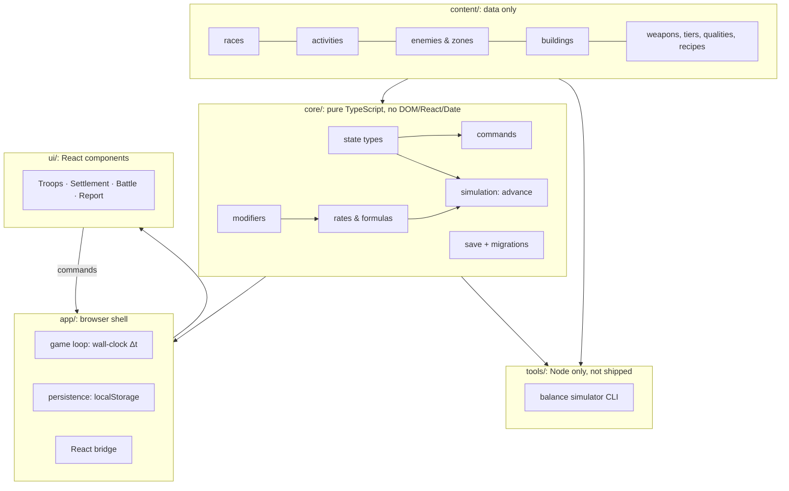

# Technical Architecture v0.2

> **Status:** Proposal. Nothing has been implemented, and no dependencies have been installed.
> **Confirmed direction ✅:** React + TypeScript + Vite + PWA, with a separate, framework-independent Game Core.
> **Related:** [Troop Model](TROOP_MODEL.md) · [Roadmap](ROADMAP.md) · [Decisions](DECISIONS.md)

---

## 1. Goals and non-goals

| The engine must handle ✅ | How 💡 |
|---|---|
| Number of soldiers per troop | `troop.size: number`. Soldiers are never objects. |
| Different race population models | Race data: caps, costs, per-soldier stats, traits |
| Combat strength and resource production | Pure rate functions, O(1) per troop |
| Recruitment and growth | Commands that validate and mutate state |
| Several troops on different activities | `troops[]`, each with one assignment |
| Efficient idle and offline progression | Event-driven `advance(state, Δt)`, the same code online and offline |

**Non-goals for now:** a backend, accounts, multiplayer, an ECS, a rule/scripting engine, a big-number library, animation frameworks.

---

## 2. Layers



**Dependency rule:** arrows only point downward. `core` never imports from `app` or `ui`. A lint rule or a simple test can enforce this later.

---

## 3. Data model (sketch)

> Type sketches for discussion. They show shape, not final code.

### 3.1 Content (static, typed data)

```ts
type ActivityKind = 'combat' | 'mining' | 'woodcutting' | 'food' | 'construction';
type ResourceId   = 'food' | 'wood' | 'stone' | 'ore';

interface RaceDef {
  id: string;                          // stable ID, never an array index
  population: {
    maxTroopSize: number;              // e.g. 500
    startSize: number;                 // e.g. 5 (Humans)
    foodPerSoldier: number;            // recruitment cost
    upkeepPerSoldier: number;          // P1
  };
  soldier: {
    attack: number;
    armourPen: number;                 // 0..1
    skills: Record<Exclude<ActivityKind,'combat'>, number>;
  };
  modifiers: Modifier[];               // passive race bonuses
  traits: string[];                    // IDs of shared, named mechanics (e.g. 'horde')
}

interface EnemyDef   { id: string; hp: number; armour: number; traits: string[]; loot: Partial<Record<ResourceId, number>>; }
interface ZoneDef    { id: string; stages: { enemyId: string; killsToClear: number }[]; boss: { enemyId: string; timeLimitSec: number }; }
interface BuildingDef{ id: string; levels: { materials: Partial<Record<ResourceId, number>>; work: number; effects: Modifier[] | Unlock[] }[]; }

// Objectives drive tutorial, unlocks and "what next?" (see FIRST_15_MINUTES.md §4)
type Unlock = { kind: 'activity' | 'tab' | 'building' | 'upgrade' | 'zone' | 'troopSlot'; id: string };
interface ObjectiveDef {
  id: string;
  requires: string[];                  // other objective ids
  condition:                           // evaluated by the core, never by the UI
    | { kind: 'resourceAtLeast'; resource: ResourceId; amount: number }
    | { kind: 'totalGathered'; resource: ResourceId; amount: number }
    | { kind: 'kills'; amount: number }
    | { kind: 'buildingBuilt'; buildingId: string }
    | { kind: 'troopAssigned'; activity: ActivityKind }
    | { kind: 'troopSizeAtLeast'; size: number }
    | { kind: 'recruited'; amount: number };
  rewards: { unlocks?: Unlock[]; resources?: Partial<Record<ResourceId, number>> };
}
```

### 3.2 Save state (plain JSON)

```ts
interface GameState {
  version: number;                     // save schema version → migrations
  contentVersion: string;
  raceId: string;
  lastSeenAt: number;                  // ms, set by the app shell (not the core)
  resources: Record<ResourceId, number>;
  troops: TroopState[];
  troopSlots: number;
  buildings: Record<string, { level: number }>;
  construction: { buildingId: string; progress: number } | null;
  combat: { zoneId: string; stageIndex: number; kills: number; boss?: { hpLeft: number; timeLeft: number } };
  objectives: { completed: string[] };  // active = requirements met & not completed (derived)
  unlocks: string[];                   // e.g. 'activity:mining', 'tab:upgrades', 'troopSlot:2'
  upgrades: Record<string, number>;    // upgradeId → level
  stats: { totalKills: number; totalGathered: Partial<Record<ResourceId, number>>; /* … */ };
}

interface TroopState {
  id: string;
  name: string;                        // player-chosen, e.g. "Norra Väktarna"
  size: number;                        // integer soldiers
  xp: number;                          // from combat → level (veterancy), derived
  gearTier: number;
  doctrineId?: string;                 // P1
  activity: ActivityKind | null;       // null = idle
}
```

**Not stored:** DPS, rates, caps or effective stats. These are always *derived* from state + content, so the save stays small and never goes stale.

---

### 3.3 Equipment (planned, see [Equipment & Crafting §6](EQUIPMENT_AND_CRAFTING.md#6-technical-foundation-))

- `troop.gearTier` (a placeholder in the current code) is replaced by `troop.weaponTypeId` + `troop.equipment: { tier, quality, count }[]` with the invariant Σ count ≤ size.
- `state.armoury: Record<"weapon:tN:quality", number>`, plus `state.crafting` (orders, mastery, quality carry).
- Combat is computed **per equipment bucket** and summed, so mixed tiers and qualities stay exact under the non-linear armour/overkill formula.
- Crafting orders are linear progress, like construction. `craftOrderCompleted` is a new simulation event. Quality is distributed deterministically (no RNG).
- Save v1 → v2 migration: every troop becomes `{ tier 1, normal, count: size }`.

## 4. Simulation model

### 4.1 One function for online and offline

```
advance(state, Δt, content) → { state, events[] }

loop:
  rates   = computeRates(state, content)          // per troop, per resource, per kill
  tEvent  = timeToNextEvent(state, rates)          // stage cleared, building done, boss timeout …
  step    = min(remaining Δt, tEvent)
  state   = integrate(state, rates, step)          // linear: amount += rate × step
  if an event happened: apply it, record it, and loop again (rates may change)
until Δt is consumed
```

- **Online:** the app calls `advance(state, ~0.1–1 s)` on a timer, using **wall-clock Δt** and never counting ticks. Throttled background tabs are therefore harmless.
- **Offline:** on load, `advance(state, min(now − lastSeenAt, offlineCap))`. Same code. It produces the "while you were away" report from `events[]` and the resource differences.
- **Cost:** offline time costs a number of steps proportional to the number of *events*, not the elapsed seconds. Even with 10 troops this is trivial.

### 4.2 Events in P0

| Event | Effect |
|---|---|
| `stageCleared` | stageIndex++, new enemy → combat rates change |
| `constructionCompleted` | building level++, effects applied, troops on construction go idle |
| `bossDefeated` / `bossFailed` | Unlocks / boss state reset (only while online) |
| `objectiveCompleted` | Rewards applied (unlocks, resources). Can complete offline, e.g. "gather 60 wood". |
| `troopLevelUp` | Troop multiplier changes → rates change |

### 4.3 Determinism

- The core never calls `Date.now()` or `Math.random()`. Time is passed in. If randomness is ever needed (e.g. loot), it comes from a seeded RNG stored in the state.
- **Key test:** `advance(s, 3600)` ≈ `advance` called 3,600 times with 1 s steps, within a small float tolerance.

---

## 5. The modifier system

Races, buildings, gear, doctrines and later heroes all **modify stats**. One shared format:

```ts
interface Modifier {
  stat: 'attack' | 'skill.mining' | 'skill.food' | 'foodPerSoldier' | 'armourPen' | /* … */;
  op: 'add' | 'mult';
  value: number;
  scope?: { activity?: ActivityKind; troopId?: string };
  source: string;                      // 'race:orcs', 'building:farm#1' → used in tooltips & debugging
}
// resolution: final = (base + Σ add) × (1 + Σ mult)   — mults stack additively within a stat;
// weapon power (tier × quality) and troop level are separate multiplicative factors (see src/core/stats.ts)
```

**Traits** that cannot be expressed as a flat modifier (Orc *Horde*: bonus depends on fullness; Orc *Raiders*: extra loot) are **small named functions** in `core/traits/`, each with its own tests. There is no DSL and no scripting.

---

## 6. Commands (player actions)

All state changes go through `dispatch(state, command, content)`, which validates the command and returns the new state or an error.

| Command | P0 |
|---|---|
| `chooseRace(raceId)` | ✅ |
| `assignTroop(troopId, activity)` | ✅ |
| `recruit(troopId, count)` | ✅ |
| `upgradeGear(troopId)` | ✅ (tier 0→1 only) |
| `startConstruction(buildingId)` | ✅ |
| `challengeBoss()` | ✅ |
| `buyUpgrade(upgradeId)` | ✅ |
| `renameTroop(troopId, name)` | ✅ |
| `setDoctrine(troopId, doctrineId)` | P1 |

Benefits: a single place for validation, easy debug logging, and a future server could replay or validate the same commands (if cloud features ever arrive).

---

## 7. Persistence

| Topic | P0 decision 💡 |
|---|---|
| Storage | `localStorage`, one key, JSON |
| Autosave | Every 15 s + on `visibilitychange` / `pagehide` |
| Versioning | `state.version` + an ordered list of `migrate_vN_to_vN+1` functions |
| Backup | **Export/import save as a text string** (essential on mobile; iOS may evict PWA storage) |
| Clock | Negative Δt → ignore. Δt > cap → clamp. No anti-cheat (single-player). |
| Later | IndexedDB if saves grow; cloud save behind the same `PersistenceAdapter` interface |

---

## 8. UI architecture (P0)

- **React bridge:** the app shell holds the state. Components subscribe through `useSyncExternalStore`. No Redux or Zustand unless a real need appears.
- **Render rate:** the UI re-renders at most ~4–10×/s. Numbers can animate with CSS.
- **Mobile-first layout:** bottom tab bar on phones, side panel on desktop.
- **P0 screens:** `Your forces` (main: troop cards with Strength/Work + activity selector + recruit, plus the current goals), `Settlement` (fixed building plots, see [First 15 Minutes §6](FIRST_15_MINUTES.md#6-settlement-presentation-recommendation--the-owners-open-question)), `Upgrades`, `Battle` (current enemy with HP bar, stage, boss), `Report` (modal after an absence), `Debug` (dev only: time ×10/×100, add resources).
- **Progressive disclosure:** tabs and buttons appear only when `state.unlocks` contains them. The UI reads unlocks and never decides them.
- **No art in P0:** emoji or simple SVG icons, plain CSS panels.

---

## 9. Folder structure (as built in M1)

```
/
├─ docs/                    ← planning
├─ src/
│  ├─ core/                 ← pure TS game core (flat and small on purpose; split when a file grows)
│  │  ├─ types.ts           ← content + state + event types
│  │  ├─ formulas.ts        ← combat (armour/overkill), caps, XP, recruit cost, modifier resolution
│  │  ├─ stats.ts           ← derived values: troop stats, traits (Horde, Raiders), all rates
│  │  ├─ simulation.ts      ← event-driven advance() and catchUp()
│  │  ├─ commands.ts        ← dispatch(): validated player actions
│  │  ├─ objectives.ts      ← goal chain / unlocks
│  │  ├─ mutations.ts       ← small shared state helpers
│  │  ├─ state.ts           ← newGame(), cloneState()
│  │  ├─ save.ts            ← versioned serialize/deserialize + migrations
│  │  └─ *.test.ts          ← co-located tests, incl. a purity check
│  ├─ content/              ← races.ts, world.ts (enemies, zone, buildings, upgrades, gear, objectives)
│  ├─ app/                  ← (M3) loop, persistence, store
│  └─ ui/                   ← (M3) React components & screens
└─ tools/
   └─ sim/                  ← bot.ts, run.ts (CLI), balance.test.ts
```

---

## 10. Dependencies: proposed budget (requires approval)

| Stage | Packages | Why |
|---|---|---|
| **Step 1: core + simulator** | `typescript`, `vitest`, `tsx` (run TS scripts) | Minimum for a tested, headless core |
| **Step 2: playable UI** | + `vite`, `react`, `react-dom`, `@vitejs/plugin-react`, `@types/react*` | UI |
| **Step 3: installable** | + `vite-plugin-pwa` | Offline/installable PWA |

Nothing else without a concrete need. Each step needs the owner's approval.

**Installed (M1, approved D-25):** `typescript@7.0.2`, `vitest@4.1.12`, `tsx@4.23.15`, all dev-only and pinned exactly. `.npmrc` sets `legacy-peer-deps=true`, because npm 10.9 crashes (`Cannot read properties of null (reading 'edgesOut')`) while resolving vitest's optional peer graph. vitest 4 already depends on vite directly, so nothing is lost. The simulator declares the two Node globals it needs (`tools/sim/env.d.ts`) instead of adding `@types/node`.

---

## 11. Testing strategy

| Test | What it protects |
|---|---|
| Formula unit tests | Combat (armour, overkill), production, recruitment cost, cap levels |
| Offline equivalence (property test) | One big Δt = many small Δt |
| Command validation | Can't recruit past the cap, can't build without materials … |
| Save fixtures | Every old save version still loads after migrations |
| **Balance simulator** | Scripted bots per race play N hours. Outputs time-to-milestone, plus warnings for dominant strategies and race outliers. |

---

## 12. Performance budget

- ≤ ~10 troops, ≤ ~20 buildings, 1 active zone → `computeRates` is microseconds.
- Offline 8 h = tens of event steps.
- Numbers: plain JS `number`. The design curve should stay far below 1e15 in early regions. Soldier counts are integers, and resources are floats displayed rounded.
