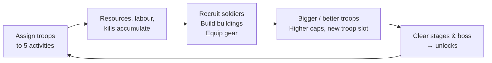

# FANTASY IDLE RPG — Concept v0.2

> **Status:** Planning. No code has been written.
> **Date:** 2026-10-22 · **Supersedes:** [v0.1](archive/FANTASY_IDLE_RPG_CONCEPT_V0.1.md)
> **Detailed documents:** [Troop Model](TROOP_MODEL.md) · [Architecture](ARCHITECTURE.md) · [Roadmap & Prototype](ROADMAP.md) · [Decisions](DECISIONS.md)

**Labels:** ✅ Confirmed · 💡 Proposed · ❓ Open

---

## 0. Executive summary

A fantasy idle game where **your army is your economy**. The player leads a small number of **troops**. Each troop is a group of soldiers that **grows** from a handful to hundreds, or to a thousand for the Orcs. Each troop is assigned to one of five activities: **Combat, Mining, Woodcutting, Food or Construction**.

Version 0.2 builds on the owner's clarifications:

1. **Troops and soldiers are different things.** ✅ The troop is the strategic unit. Soldiers are a count. Nothing is simulated per soldier.
2. **Races differ through their population model.** ✅ Orcs field huge hordes of weak soldiers, Dwarves and Elves small elite bands, and Humans sit in between. 💡 To make that more than cosmetic, the combat and economy formulas deliberately reward *size* in some situations and *quality* in others ([Troop Model §2](TROOP_MODEL.md#2-the-central-design-problem-size--quality-must-not-cancel-out)).
3. **The start area offers all five activities with free switching.** ✅ The scarcity is the *single troop*, not a switching cost.
4. 💡 **The first prototype (P0)** is tiny: Humans + Orcs, one zone of chickens, foxes and boars, four buildings and at most two troops. It runs about 20–40 minutes and is built **headless first** (game core + balance simulator) before any UI.

---

## 1. What changed since v0.1

| Area | v0.1 | v0.2 | Status |
|---|---|---|---|
| Troop concept | "Troop group" with a size, loosely defined | **Troop = group of N soldiers**, growing via recruitment up to a race-specific cap | ✅ |
| Races | Mostly stat modifiers + one signature mechanic | **Population model** (cap, growth speed, cost, per-soldier quality) + activity profile + traits | ✅ / 💡 |
| Activities | Fight, Mine, Log | **Combat, Mining, Woodcutting, Food, Construction** | ✅ |
| Switching | March time between all activities | **Free in the start area**; travel time between regions later | ✅ |
| Resources | Gold, Wood, Iron | **Food, Wood, Stone, Ore** (no gold for now) | 💡 |
| Combat | DPS vs HP + trait counters | **Armour + overkill model**: size beats swarms, quality beats armour | 💡 |
| First playable | 1 race, 3 zones, 3 slots, 60–90 min | **2 races, 1 zone, 2 troops, 20–40 min**, headless first | 💡 |
| Upkeep | Open, leaning "no" | **Soft upkeep in P1** (Food now needs a purpose) | 💡 |
| Docs | One file | Split into concept, troop model, architecture, roadmap and decision log | — |

Unchanged from v0.1, and still valid: the pillars (§2), idle/offline principles, the case for React + TS over Godot/Phaser, the risk analysis, heroes as commanders, and the long-term expansion ideas. See the [v0.1 archive](archive/FANTASY_IDLE_RPG_CONCEPT_V0.1.md) for the full reasoning.

---

## 2. Vision & pillars

> *Lead your people out of a ruined age. Raise your banners from a handful of soldiers into an army. Every banner is precious: will it hold the line, dig the mountains, feed the camp or raise the walls?*

| Pillar | Meaning in v0.2 |
|---|---|
| **1. Every troop matters** | Few troops, each with a name, a growing size and a history. A new troop is a major event. |
| **2. War and economy are one system** | All five activities feed each other. Neglecting one blocks another. |
| **3. Your race is your strategy** | Population size and soldier quality change *which* activities and enemies suit you, not just your numbers. |
| **4. Decisions over reflexes** | No action combat. The skill is allocation and timing. |
| **5. Respectful idle** | Being away is rewarded. No punishing timers, no offline losses. |

---

## 3. Core loop



| Activity | Produces | Needed for |
|---|---|---|
| ⚔️ **Combat** | Zone progress, boss unlocks, some loot | New stages and regions, troop slots |
| ⛏️ **Mining** | Stone, Ore | Construction (stone), gear (ore) |
| 🪓 **Woodcutting** | Wood | Construction |
| 🌾 **Food** | Food | Recruitment (+ upkeep in P1) |
| 🔨 **Construction** | Building progress (labour) | Caps, troop slots, gear tiers, production bonuses |

The full resource-flow diagram is in [Troop Model §9](TROOP_MODEL.md#9-resource-flow-in-the-start-area-p0).

### 3.1 The first 10 minutes (illustrative, Humans) 💡

| Min | What happens | Decision |
|---|---|---|
| 0–1 | Choose your race. Troop 1 "First Banner" has 10 soldiers. A short intro text. | Race |
| 1–3 | Fight chickens. Kills tick up quickly and drop a little food. | — |
| 3–5 | Recruiting costs food. Switch the troop to Food and recruit up to 50 (the cap). | Fight or grow? |
| 5–8 | The Barracks and Training Grounds need wood + stone + labour. Woodcutting, Mining, then Construction. | Order of work |
| 8–10 | Barracks done (cap 125), *or* Training Grounds done (🎉 Troop 2). | Bigger troop vs second troop |

**Orcs, same 10 minutes:** they start with 30 and recruit very cheaply, so they hit their cap almost immediately and steamroll the chickens. But they gather slowly, so the buildings take longer and every activity switch hurts more. **The same start area, but a different first ten minutes.** ✅ goal

---

## 4. Race system: summary

The full specification is in [Troop Model §3–6](TROOP_MODEL.md#3-per-soldier-quality).

| | Humans | Orcs | Dwarves | Elves |
|---|---|---|---|---|
| Max troop size 💡 | 500 | 1000 | 200 | 150 |
| Soldier quality | Medium | Low | High | High + precision |
| Growth | Steady | Very fast, cheap | Slow, expensive | Slow, expensive |
| Strong at | Everything, decently; construction | Swarms; raiding for loot | Mining, construction, armour | Wood, food, armour, bosses |
| Weak at | Nothing in particular | Armour, all labour | Swarms, food | Swarms, mining |
| In P0? | ✅ | ✅ | P1 | P1 |

**Principle:** races are **data** (numbers, modifiers, trait IDs) on top of shared systems. Adding a race = one data file + art. 💡

---

## 5. Troop system: summary

See [Troop Model](TROOP_MODEL.md) for formulas and worked examples.

- **Size:** grows by recruiting (food, plus ore if the troop is equipped). Limited by a cap that Barracks raise. 💡
- **Quality:** race base × gear tier × doctrine × traits × upgrades, all through one modifier system. 💡
- **Assignment:** one activity per troop; free in the start area; travel time later. ✅
- **Slots:** Troop 2 via construction, Troop 3 via the boss, more later. 💡
- **Specialisation:** Doctrine (a chosen focus) in P1. Proficiency (learning by doing) maybe later. ✅ concept / 💡 method

---

## 6. Idle & offline

- One event-driven simulation function handles both online play and offline catch-up ([Architecture §4](ARCHITECTURE.md#4-simulation-model)). 💡
- Offline: production, construction and combat farming continue. There are no boss fights and no automatic recruitment. 8 h cap in P0, extended by upgrades later. 💡
- On return: a **"While you were away"** report (kills, resources, completed buildings, idle troops). 💡
- Save: localStorage + **export/import string** from day 1, with versioned migrations. 💡

---

## 7. Technical architecture: summary

✅ React + TypeScript + Vite + PWA, with a separate Game Core. Details: [Architecture](ARCHITECTURE.md).

```
content (data) ──► core (pure TS: state, commands, formulas, advance) ──► app shell (loop, save) ──► React UI
                         └──► tools/sim (headless balance simulator)
```

- Soldiers are a number. Every rate is O(1) per troop. Offline time costs one calculation per *event*, not one per second.
- Derived values (DPS, rates, caps) are never stored.
- The dependency budget is minimal, and each step needs approval ([Architecture §10](ARCHITECTURE.md#10-dependencies-proposed-budget-requires-approval)).

---

## 8. First playable prototype (P0): summary

See [Roadmap §2](ROADMAP.md#2-prototype-p0-the-farmstead-camp).

| | P0 "The Farmstead Camp" |
|---|---|
| Races | Humans, Orcs |
| Troops | 1 → 2 |
| Activities | All 5 |
| Resources | Food, Wood, Stone, Ore |
| Zone | The Farmsteads: Chickens → Foxes → Wild Boar → 👑 The Old Tusker |
| Buildings | Barracks, Training Grounds, Forge, Farm |
| Gear | Tier 0 → 1 |
| Length | ~20–40 min |
| Art | None (emoji/SVG icons) |
| Build order | **Headless core + simulator first**, then UI |

---

## 9. Long-term expansion (unchanged direction)

Roughly in this order, each one only after the previous step is validated: Dwarves & Elves → doctrines & soft upkeep → Region 2 with travel time → expeditions → heroes as troop **commanders** (deterministic recruitment, no gacha) → buildings/stronghold depth → prestige ❓ → territories → cloud save → store release. Speculative: world map, async online features. Not recommended: PvP.

---

## 10. Top risks (updated)

| # | Risk | Mitigation |
|---|---|---|
| 1 | **Race differences turn out cosmetic** (size × quality cancels out) | Six-lever model; the simulator compares races per enemy type and per activity |
| 2 | **One allocation dominates**, so the five activities collapse into one or two | Interdependent resources; simulator bots look for dominant strategies |
| 3 | **Scope creep** (four races, heroes and a map before the core is fun) | Strict P0; a "not now" list; approval gates per milestone |
| 4 | **Balance across very different scales** (150 vs 1000 soldiers) | Cap levels as shared fractions; tuning through a few global constants; simulator per race |
| 5 | **Save loss on mobile web** | Export/import from day 1; versioned migrations; persistent storage request |

---

## 11. Recommendation and next step

👉 **Approve M1–M2:** set up a minimal TypeScript project (`typescript`, `vitest`, `tsx`). Build the headless core with P0 content, then a simulator that plays Humans vs Orcs and prints timelines. No UI yet. That answers the most important question first: *do the races really play differently?*

The open questions are in [DECISIONS.md](DECISIONS.md#open-).
