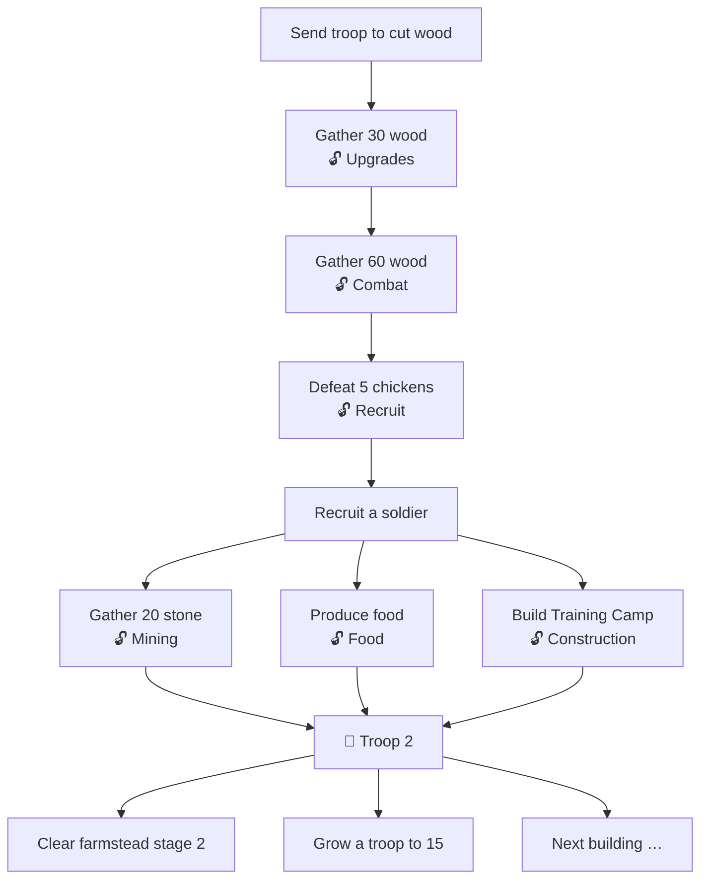

# The First 15 Minutes: Onboarding Design v0.3

> **Status:** The owner's vision (✅) translated into a concrete, numbered design (💡). Numbers are tuning starting points; the balance simulator will verify them.
> **Related:** [Troop Model](TROOP_MODEL.md) · [Roadmap / Prototype P0](ROADMAP.md) · [Decisions](DECISIONS.md)

**Labels:** ✅ Confirmed (owner) · 💡 Proposed · ❓ Open

---

## 1. Goal of the first session ✅

> **From a small, insignificant patrol to the beginning of a working settlement.**

What the player should understand after 15 minutes:

> **"My troops are my most important resource. I decide what they do, and that changes how my realm develops."**

| Principle ✅ | Consequence for the design 💡 |
|---|---|
| A lot happens, but no flood (not 50 soldiers, 10 buildings and 3 heroes) | After 15 min: **2 troops, ~12 soldiers, 1 building, 1 area** |
| Progress through **goals and dependencies, not timers** | A small, data-driven *objectives* system drives every unlock. Nothing unlocks just because time passed. |
| Guided at first, then freedom | One highlighted goal at a time for ~5 min, then 2–3 parallel goals the player can order freely |
| Troop 2 is **the first big reward**, around minute 10–15 of *active* play | Training Camp is the only building in the first session, and it unlocks Troop 2 |
| Combat is clearly different from gathering | Gathering = steady progress bar. Combat = enemy with HP, kills, food + **XP**, progression. |

---

## 2. Base numbers (Humans, tutorial scale) 💡

Chosen to match the owner's example ("5 soldiers → 5 DPS, 5 work, 5 wood every 10 seconds").

| Per soldier | Value | Troop card shows |
|---|---|---|
| Attack | 1 damage/s | **Strength:** size × attack → "5 DPS" |
| Work | 1 | **Work:** size × work → "5" |
| Gathering yield | Work × race skill × **0.1/s** | Wood: 5 × 1.0 × 0.1 = **0.5/s = 5 per 10 s** ✓ |
| Construction | Work × construction skill → work points/s | 8 Humans: 8 × 1.2 = 9.6/s |
| Recruit cost | **5 food** per soldier (Humans) | "+1 soldier · 5 🌾" |

💡 **UI simplification adopted from the owner's mock-up:** the troop card shows only two headline stats, **Strength (DPS)** and **Work**. Activity output is derived from Work × the race's skill for that activity, and is shown when the troop is assigned (e.g. "0.5 wood/s").

### Start-area content

| Thing | Values |
|---|---|
| Troop 1 | **5 / 20 soldiers** ✅ |
| 🐔 Wild Chicken (Lv 1) | HP 30, armour 0 · reward **3 food + 2 XP** · 5 DPS → one kill per 6 s |
| Troop level (veterancy) | Lv 2 at 30 XP, Lv 3 at 90 XP … each level gives +10% Strength and Work |
| Upgrade "Sharpened Axes" | 30 wood → +50% Woodcutting |
| Upgrade "Drill Practice" | 20 food + 20 wood → +25% Strength |
| 🏕️ **Training Camp** | **40 wood · 20 stone · 15 food** ✅ + **400 work** (≈ 40–50 s with 8 soldiers) |
| Training Camp effects | Troop cap **20 → 40** · **Troop 2 unlocked**, formed with **3 soldiers** for free ("volunteers from the camp") |

---

## 3. Minute by minute (Humans) 💡

Assumes a player who acts reasonably promptly. Every step is triggered by a **goal**, never by a timer.

| Time | What happens | Goal shown (completing it unlocks the next step) | Player decision |
|---|---|---|---|
| **00:00–01:00** | Choose race. Straight to the outpost. Troop card: *Norra Väktarna · 5/20 · 5 DPS · Work 5 · Activity: None* | 🎯 *"Your troop awaits orders. Send it to cut wood."* | Race |
| **01:00–02:00** | Woodcutting: the progress bar fills and **+5 wood every 10 s** | 🎯 *"Gather 30 wood"* → unlocks the **Upgrades** tab | — |
| **02:00–03:30** | **First real choice:** buy *Sharpened Axes* (30 wood) now, or save for something bigger? The game shows both but chooses for no one. | 🎯 *"Gather 60 wood in total"* (reached sooner with axes) | **Spend or save** |
| **03:30–04:00** | Combat unlocks: *"Chickens have been spotted by the old farm."* | 🎯 *"Defeat 5 chickens"* | — |
| **04:00–06:00** | Combat: HP bar, 6 s per kill, **+3 food +2 XP** per kill. Troop reaches **Lv 2** around minute 5. After 5 kills, **Recruit** unlocks. | 🎯 *"Recruit a soldier"* | **Recruit (5 food) vs Drill Practice** |
| **06:00** | Troop is ~7–8 soldiers. **From here, guidance loosens.** Mining, Food and the **Training Camp** blueprint appear together. | 🎯🎯🎯 Three parallel goals: *"Gather 20 stone"*, *"Produce food in the fields"*, *"Build the Training Camp"* | **Order of work** |
| **06:00–09:00** | One troop, three needs. The player moves the troop between Mining (≈25 s for 20 stone), Woodcutting (≈35 s for missing wood) and Food. *"It would be nice to have another troop…"* | — | **Allocation, with one troop** |
| **09:00–10:00** | Construction: the troop builds the Training Camp, **400 work ≈ 40–50 s**. The other activities stop meanwhile. | 🎯 *"Build the Training Camp"* | — |
| **≈10:00** | 🎉 **Milestone:** *"The Training Camp stands. A second banner can be raised."* Cap 20 → 40. **Troop 2 is formed (3 soldiers), and the player names it.** | 🎯 *"Give your new troop orders"* | **Name the troop** |
| **10:00–15:00** | **Two things at once:** *Norra Väktarna* fights (~9 soldiers, 9 DPS), *Skogsarbetarna* cut wood (3 soldiers ≈ 18 wood/min). Hand-holding ends. | Open goals: *"Clear the farmstead (stage 2/5)"*, *"Grow a troop to 15"*, *"Prepare the next building"* | **Free play** |

### After 15 minutes (target) ✅

| Troops | Soldiers | Buildings | Areas | Activities tried |
|---|---|---|---|---|
| **2** | **~12** | **1** | **1** | **5 / 5** |

> ⚠️ *Note on the owner's example:* "Skogsarbetarna · 3 soldiers · 6 wood/min" doesn't match "5 soldiers → 5 wood per 10 s" (30/min). With the base numbers above, 3 soldiers make **18 wood/min**. I've used the consistent figure.

---

## 4. The objectives system (replaces timers *and* a tutorial engine) 💡

One small, data-driven system does three jobs: the tutorial, progression gates and "what should I do next?"

```
Objective = {
  id, text,
  requires: [objective ids],           // dependency chain
  condition: e.g. resource ≥ N | building built | kills ≥ N | troop assigned to X | troop size ≥ N
  rewards:  unlock (activity / tab / building / zone / troop slot) and/or small resources
}
```



- Steps O1–O5 are **linear** (≈ 5–6 min). From O6 the goals branch, which addresses the owner's own concern about too much guidance.
- 💡 Mining and Food unlock *together* at O5, so the player is never forced through all five activities in a fixed order.
- Objectives are **content data**. The tutorial can be rewritten without touching the game core.

### Progressive UI disclosure 💡

| Unlocked by | Becomes visible |
|---|---|
| Start | Troop card, resource bar (wood only) |
| O2 | Upgrades tab |
| O3 | Battle tab |
| O4 | Recruit button |
| O5 | Mining, Food, Settlement tab, stone and food in the resource bar |
| O7 | Second troop card. The "Your forces" overview becomes the main screen. |

The owner wrote "unlock the ability to leave the troop working while looking at other menus". In this design, **troops always keep working**, and what unlocks is the *tabs*. The effect for the player is the same, and it needs no special rule.

---

## 5. Orcs in the same 15 minutes 💡 (same rules, different race data)

| | Humans | Orcs |
|---|---|---|
| Troop 1 at start | 5 / 20 | **10 / 40** |
| Strength | 5 × 1.0 = 5 DPS | 10 × 0.4 × Horde = **~4.5 DPS** |
| 30 wood | ~60 s | **~43 s** (wood skill 0.7 × 10 soldiers) |
| Recruit cost | 5 food | **1.25 food**, and *Raiders* gives +50% food per kill |
| 20 stone | ~25 s (8 soldiers) | ~33 s (20 Orcs, mining skill 0.3) |
| Training Camp (400 work) | ~45 s | **~70 s** (≈ 20 Orcs × 0.3) |
| Troop 2 forms with | 3 soldiers | **6 soldiers** |
| After 15 min | 2 troops · ~12 soldiers | 2 troops · **~25–30 soldiers** |
| Feel | Steady, efficient | **Many, clumsy, hungry**: wood and bodies are easy, building and stone are slow |

**Target:** both races reach Troop 2 within **10–13 minutes** of active play. The simulator checks this.

---

## 6. Settlement presentation: recommendation 💡 (❓ the owner's open question)

The owner asked: *a visible settlement that grows with the army, or buildings as upgrades in a menu?*

| Option | Feel | Cost for a solo developer | Risk |
|---|---|---|---|
| **A. Menu upgrades only** | Efficient, "spreadsheet" | Lowest | Loses the emotional arc *patrol → settlement*, which is the owner's own goal sentence |
| **B. Free-placement city builder** | Strong ownership | **Very high** (placement, layout, art per building, two control schemes) | Becomes a second game that competes with the troops for attention |
| **C. 💡 Fixed-plot settlement** | You *see* your outpost grow, while the troops stay the focus | Low–medium | Small |

**Recommendation: Option C, a fixed-plot settlement.**

- The **Settlement** screen shows the camp as **a set of fixed plots** (e.g. 6–8), each with a building card. There is no free placement, no roads and no adjacency rules.
- The settlement has **named growth stages** that change the screen's header illustration. One image per stage, not per building: *Patrol camp → Outpost → Fortified camp → Village → Stronghold*. That is about 5 illustrations in total, and it gives a strong sense of progress.
- **Troops build everything.** A construction plot shows *who* is working on it: *"Skogsarbetarna are building: Training Camp 64%"*. This keeps the settlement tied to the core message that *troops are your most important resource*.
- The **main screen remains "Your forces"**, with the troop cards. The settlement is the second tab.
- **P0:** plots as simple cards with icons, no illustrations. Art arrives in the identity phase.

---

## 7. Differences from the previous plan (v0.2)

| Area | v0.2 | v0.3 (this document) |
|---|---|---|
| Start size | Humans 10 / Orcs 30, cap 50 / 100 | **Humans 5 / 20, Orcs 10 / 40** |
| First building | Barracks *or* Training Grounds (a choice) | **Training Camp**: cap increase + Troop 2 in one ✅ |
| Combat reward | Zone progress + loot | **+ troop XP and levels** (veterancy) ✅ |
| Unlock pacing | Not specified | **Objectives system** with dependencies; no timer unlocks ✅ |
| Tutorial | "A few hint texts" | Objectives *are* the tutorial (no separate engine) |
| Troop names | Default names | **The player names Troop 2** (and can rename Troop 1). It's cheap and builds attachment 💡 |

---

## 8. Open questions ❓

| ID | Question | Lean |
|---|---|---|
| Q-09 | Settlement presentation: menu, fixed plots or a city builder? | **Fixed plots** (§6) |
| Q-10 | The race picker shows four races. Are Dwarves and Elves **locked ("coming soon")** in P0, or playable with rough numbers? | Locked in P0 (D-12), playable in P1 |
| Q-11 | Does Troop 2 form with free soldiers, or does the player pay to fill it? | 3 free (Humans) / 6 free (Orcs) |
| Q-12 | Is XP per troop (veterancy) enough, or should XP also be a spendable currency? | Per-troop levels only. A second currency is not needed yet. |
