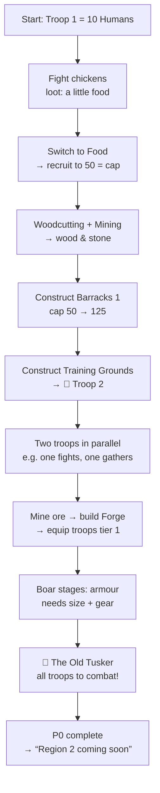

# Development Roadmap & First Prototype v0.2

> **Status:** Proposal. Time estimates assume part-time solo development with AI assistance and are indications only.
> **Related:** [Concept v0.2](FANTASY_IDLE_RPG_CONCEPT_V0.2.md) · [Troop Model](TROOP_MODEL.md) · [Architecture](ARCHITECTURE.md)

---

## 1. Milestones at a glance

| # | Milestone | Output | Needs approval | Est. |
|---|---|---|---|---|
| **M0** | Planning v0.2 | These documents | — | ✅ done |
| **M1** | Headless core | TS game core + P0 content (Humans + Orcs) + unit tests | ⚠️ `typescript`, `vitest`, `tsx` | 1–2 weeks |
| **M2** | Balance simulator | CLI: bots play both races, print timelines | — (same deps) | 3–5 days |
| **M3** | Prototype P0 playable | Minimal React UI, save/load, offline report | ⚠️ `vite`, `react` … | 2–3 weeks |
| **M4** | Playtest P0 | Owner + 3–5 testers, tuning | — | 1–2 weeks |
| **M5** | P1: Depth | Doctrines, upkeep, troop 3, boss reward, Dwarves & Elves | — | 3–5 weeks |
| **M6** | P2: World | Region 2, travel time, gear tier 2, expeditions | — | TBD |
| **M7** | Identity | Final names, art direction, UI skin, PWA install | ⚠️ `vite-plugin-pwa` | TBD |

**Gate after M4:** if P0 doesn't feel good, iterate on the troop model and its formulas, not on new features.

---

## 2. Prototype P0: "The Farmstead Camp"

### 2.1 The questions P0 must answer

1. **Does growing a troop feel good?** Watching *10 → 50 → 225* soldiers, and buying the next batch.
2. **Do Humans and Orcs feel clearly different within 10 minutes?**
3. **With one troop, does choosing between five activities create real decisions?**
4. **Is unlocking Troop 2 a big, exciting moment?**
5. **Does coming back after offline time feel rewarding?**

### 2.2 Scope: IN ✅

| Area | Content |
|---|---|
| **Races** | **2: Humans and Orcs.** They are the clearest contrast in the population model (medium vs. huge). Data only, no race-specific UI. |
| **Troops** | Start with 1. **Troop 2** is unlocked by building *Training Grounds*. Max 2. |
| **Activities** | All 5: Combat, Mining, Woodcutting, Food, Construction. Free switching. |
| **Resources** | 4: Food, Wood, Stone, Ore |
| **Combat** | 1 zone, *The Farmsteads*: 5 stages + boss |
| **Enemies** | 🐔 Chickens (swarm, stages 1–2) · 🦊 Foxes (fast and weak, stage 3) · 🐗 Wild Boar (armoured, stages 4–5) · 👑 **Boss: The Old Tusker** (high HP + armour, 60 s time limit) |
| **Buildings** | 4: **Barracks** (troop cap levels 1–3) · **Training Grounds** (Troop 2) · **Forge** (unlocks gear tier 1, which costs ore per soldier) · **Farm** (+50% Food output) |
| **Recruitment** | Buttons +1 / +10 / +max, costing food (+ ore if the troop is equipped) |
| **Gear** | Tier 0 → 1 (×1.4 attack), cost = ore × troop size |
| **Idle/offline** | Continuous progress. Offline cap 8 h. "While you were away" report. |
| **Save** | localStorage autosave + export/import string |
| **UI** | One main screen of troop cards, a resource bar, Settlement and Battle tabs. Emoji/SVG icons, no artwork. |
| **Dev tools** | Debug panel (time ×10/×100, add resources), balance simulator |
| **Play length** | ~20–40 minutes to defeat the boss |

### 2.3 Scope: OUT ❌ (explicitly)

Dwarves & Elves (the data model supports them; they are added in P1) · Doctrines/specialisation · Proficiency · Food upkeep · Troop 3+ · Travel time · Region 2 · Gear tier 2+ · Expeditions · Heroes · Equipment items · World map · Story/quests · Casualties · Prestige · Sound · Art · Backend/cloud · Monetisation · App stores · Localisation · Tutorial system (a few hint texts are enough)

### 2.4 Intended progression (illustrative, Humans)

### 2.5 Where the decisions are

| Moment | Decision | Why it isn't trivial |
|---|---|---|
| Minutes 1–5 | Fight (loot, progress) or produce food (recruitment)? | One troop; both matter |
| Barracks vs Training Grounds | More soldiers per troop, or a second troop? | Same materials, different benefits |
| After Troop 2 | How to split two troops over five activities | Construction needs labour *and* materials |
| Forge | Equip now (ore × size) or recruit more first? | Gear gets more expensive the bigger the troop |
| Boar stages | Is the army big enough, or does it need gear? | Armour model (see [Troop Model §5.3](TROOP_MODEL.md#53-combat-the-overkillarmour-model)) |
| Boss | Pull every troop off the economy to make the DPS check? | Time limit |
| **Orcs vs Humans** | Orcs: chickens are trivial but the boar is a wall and they gather slowly. Humans: steadier, no extremes. | Population model |

### 2.6 P0 success criteria

| Signal | Target |
|---|---|
| The owner voluntarily replays with the other race | Yes |
| Testers describe Humans and Orcs differently in their own words | ≥ 3 of 5 |
| Testers switch activities for a stated reason | Most of them |
| Testers come back after closing | ≥ 50% within 24 h |
| Simulator: no single allocation is optimal throughout | The optimal allocation changes ≥ 3 times |
| Simulator: time to boss, Orcs vs Humans | Within ±25% (tuning target) |

---

## 3. M1 + M2 in more detail (recommended next step)

**Why start without a UI:** the troop model is the riskiest and most important part. A headless core plus a simulator can show within days whether Humans and Orcs behave differently, and whether any activity is useless, before any time goes into UI.

| Task | Result |
|---|---|
| Project setup (TS, Vitest, tsx), *after approval* | `package.json`, `tsconfig`, test script |
| Content: Humans, Orcs, 5 activities, 4 enemies, 1 zone, 4 buildings, gear tiers | `src/content/*` |
| Formulas: production, combat (armour + overkill), recruitment, caps | `src/core/formulas/*` + tests |
| Modifiers + traits (Horde, Raiders) | `src/core/modifiers.ts`, `traits/*` + tests |
| Commands + validation | `src/core/commands.ts` + tests |
| Event-driven `advance()` | `src/core/simulation.ts` + offline equivalence test |
| Save schema v1 + export/import | `src/core/save/*` + fixture test |
| Simulator: 3 bot strategies × 2 races | `tools/sim`: prints a timeline (minute: troop sizes, resources, stage, buildings) |

**Definition of done for M2:** one command prints a comparison along the lines of *"Humans reached the boss in 27 min, Orcs in 31 min; Orcs spent 40% of their time on combat vs Humans' 25%"*, and the result can be discussed and tuned.

---

## 4. Working method (owner on mobile)

- **Documentation and planning:** Claude commits and pushes directly (as agreed).
- **Code, from M1 onward:** 💡 suggestion: work on a branch per milestone and open a pull request that the owner can review and merge from the phone. ❓ To be confirmed.
- **Decisions** are recorded in [DECISIONS.md](DECISIONS.md) so nothing gets lost between sessions.
- **No new dependencies or large implementations** without explicit approval. ✅
