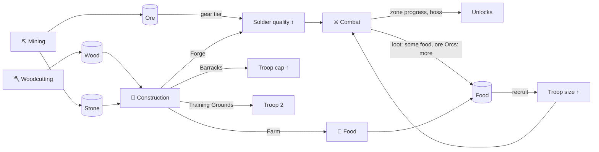

# Troop Model: Design Specification v0.2

> **Status:** Proposal for discussion. All numbers are **illustrative**: they show the *shape* of the system, not final balance.
> **Related:** [Concept v0.2](FANTASY_IDLE_RPG_CONCEPT_V0.2.md) · [Architecture](ARCHITECTURE.md) · [Decisions](DECISIONS.md)

**Labels:** ✅ Confirmed (decided by the project owner) · 💡 Proposed · ❓ Open

---

## 1. Core definitions

| Term | Definition | Status |
|---|---|---|
| **Soldier** | One individual. **Never simulated individually.** It exists only as a count and as per-soldier stats that come from the race, gear and doctrine. | ✅ |
| **Troop** | A persistent group of soldiers of one race. It has a **size** (e.g. 0–500) that grows through recruitment. It is the unit the player assigns, upgrades and develops. | ✅ |
| **Troop slot** | The capacity to field one more troop. Rare, and unlocked by milestones. | 💡 |
| **Activity** | What a troop is doing: **Combat, Mining, Woodcutting, Food, Construction**. One activity per troop at a time. | ✅ |
| **Population model** | The race's rules for how big troops get, how fast and cheaply they grow, and how good each soldier is. | ✅ (concept) / 💡 (details) |

```
Troop "1st Banner"  (Humans)
├─ size        212 / 350        ← recruitment fills it, buildings raise the cap
├─ soldier     atk 1.0 × gear ×1.4 × doctrine ×1.0
├─ doctrine    —                ← specialisation (P1)
└─ assignment  Combat → Farmsteads, stage 4
```

The UI always shows **one card per troop**, never one row per soldier. ✅

---

## 2. The central design problem: size × quality must not cancel out

If every output is simply `size × quality`, then *1000 orcs × 0.5* equals *200 dwarves × 2.5*, and race choice turns cosmetic again: the same number reached with different labels. That is exactly what the owner wants to avoid ("much more than a few percent extra damage").

💡 **Solution: let size and quality matter *differently* in different situations.** The proposal uses six levers. Each is simple on its own, and each is data, not race-specific code:

| # | Lever | Favours **large** troops (Orcs, Humans) | Favours **high quality** (Dwarves, Elves) |
|---|---|---|---|
| 1 | **Overkill** in combat: one hit kills at most one enemy | ✔ swarms of weak enemies | |
| 2 | **Armour** reduces weak hits proportionally more | | ✔ armoured enemies and bosses |
| 3 | **Recruitment cost and cap**: how fast a troop can grow | ✔ cheap and fast | expensive and slow |
| 4 | **Gear is paid per soldier** (ore × size) | | ✔ cheap to equip a small elite |
| 5 | **Food upkeep per soldier** (P1) | | ✔ small armies eat little |
| 6 | **Activity skill profile** per race | depends on the race | depends on the race |

Together these give each race a *different curve and different best uses*, while roughly similar total power at comparable stages keeps balance manageable.

---

## 3. Per-soldier quality

Each race defines a **soldier profile**. Every value is a per-soldier rate.

### 3.1 Illustrative race profiles 💡

| Stat (per soldier) | Humans | Orcs | Dwarves | Elves |
|---|---|---|---|---|
| **Attack** | 1.0 | 0.4 | 2.5 | 2.6 |
| **Armour penetration** | 0% | 0% | 0% | **50%** |
| **Mining** skill | 1.0 | 0.3 | **3.0** | 1.0 |
| **Woodcutting** skill | 1.0 | 0.4 | 1.0 | **3.5** |
| **Food** skill | 1.0 | 0.3 | 0.8 | **3.5** |
| **Construction** skill | **1.2** | 0.3 | **3.0** | 1.5 |
| Food upkeep (relative, P1) | 1.0 | 1.0 | 1.5 | 0.5 |

### 3.2 Quality multipliers (shared by all races)

```
effective per-soldier stat =
    race base stat
  × gear tier multiplier        (e.g. ×1.0 / ×1.4 / ×1.9 …)        P0: tier 0–1
  × doctrine multiplier         (specialisation, see §7)             P1
  × racial trait multiplier     (e.g. Orc "Horde", see §6)           P0 for Orcs
  × global upgrades / buildings (e.g. Farm +50% Food)                P0
```

All multipliers are **modifiers** in one shared system (see [Architecture §5](ARCHITECTURE.md#5-the-modifier-system)).

---

## 4. Population: troop size, caps and recruitment

### 4.1 Caps are race-scaled, but progress is shared 💡

Each race defines a **maximum troop size**. Buildings (Barracks) unlock **cap levels** that are the *same fraction* for every race. This gives one progression system with race-specific scale.

| Barracks level | Fraction of race max | Humans | Orcs | Dwarves | Elves |
|---|---|---|---|---|---|
| 0 (start) | 10% | 50 | 100 | 20 | 15 |
| 1 | 25% | 125 | 250 | 50 | 38 |
| 2 | 45% | 225 | 450 | 90 | 68 |
| 3 | 70% | 350 | 700 | 140 | 105 |
| 4 | 100% | **500** | **1000** | **200** | **150** |

- **Start size** (the first troop's soldiers at the beginning): Humans 10, Orcs 30, Dwarves 4, Elves 3.
- 💡 *About "Orcs: 1000 from the start":* I recommend **against** starting at the full 1000, because the growth loop is a core reward and it would disappear for Orcs. Instead Orcs **start biggest (30), recruit cheapest and grow fastest**, and they reach hundreds within the first session. The horde fantasy comes early without skipping progression. ❓ *Decision needed.*

### 4.2 Recruitment 💡

```
recruit N soldiers into troop T:
    cost = N × (race.foodPerSoldier + gearTier.orePerSoldier)
    constraint: T.size + N ≤ cap(T)
```

| Race | Food per soldier | Food to fill max cap (tier-0 gear) | Feel |
|---|---|---|---|
| Orcs | 1 | 1 000 | Cheap bodies, numbers flood in |
| Humans | 4 | 2 000 | Steady |
| Dwarves | 12 | 2 400 | Each recruit is an investment |
| Elves | 15 | 2 250 | Few, precious |

- **Gear cost is per soldier.** Recruiting into an equipped troop also costs ore for the new soldiers' gear. Upgrading a troop's gear tier costs `size × ore`. → *Equipping a horde is expensive; equipping an elite is cheap* (lever 4).
- 💡 **Recruitment is a manual purchase** in P0 (buttons: +1 / +10 / +max). That is a clear decision point and easy to tune.
  - ❓ Alternative: *continuous mustering* (troops grow automatically over time while food is consumed). More "idle", fewer decisions. Could arrive later as an upgrade ("Recruiting Sergeant: auto-recruit").
- 💡 **Troops do not shrink** in P0 (no casualties). Losses offline feel punishing. Revisit later with care.

### 4.3 Troop slots 💡

| Slot | Unlock (P0 proposal) | Why |
|---|---|---|
| Troop 1 | Start | — |
| Troop 2 | **Construct "Training Grounds"** (wood + stone + labour) | Forces use of *economic* activities |
| Troop 3 | **Defeat the start area boss** (P1) | Rewards *combat* progress |
| Troop 4+ | Later regions / milestones | — |

❓ *Variant worth considering:* different races get **different numbers of troop slots**, e.g. Elves have more but smaller troops (flexible), Orcs fewer but huge hordes. That is very strong identity, but it doubles the balancing axes. Recommendation: not in P0/P1; note for later.

---

## 5. Activity output formulas 💡

All formulas are **O(1) per troop**. There is no per-soldier loop anywhere.

### 5.1 Resource activities (Mining, Woodcutting, Food)

```
output per second = size × skill[activity] × multipliers × baseRate[activity]
```

| Activity | Produces (P0) | Main use |
|---|---|---|
| **Mining** | Stone + Ore (e.g. 70/30 split) | Stone → construction; Ore → gear |
| **Woodcutting** | Wood | Construction |
| **Food** | Food | Recruitment (+ upkeep in P1) |

Illustrative labour output **at max cap** (skill × size):

| | Humans (500) | Orcs (1000) | Dwarves (200) | Elves (150) |
|---|---|---|---|---|
| Mining | 500 | 300 | **600** | 150 |
| Woodcutting | 500 | 400 | 200 | **525** |
| Food | 500 | 300 | 160 | **525** |
| Construction | **600** | 300 | **600** | 225 |
| *Identity* | *Good at everything* | *Bad workers → must fight/raid* | *Miners & builders* | *Foresters & foragers* |

### 5.2 Construction

Construction is a **labour sink**, not a resource producer:

```
building project = { materials: {wood, stone, ore?}, work: W }
materials are paid when the project starts
work progress per second = Σ (size × constructionSkill × multipliers) of troops assigned to Construction
project completes when progress ≥ W
```

- Several troops can work on the same project, and their work adds up.
- One active project at a time in P0 (no queue). When it completes, the troop **stays on Construction, idle**, and the "while you were away" report says so. ❓ A queue might come later.

### 5.3 Combat: the overkill/armour model

Enemies come in a zone with stages. Each enemy type has **HP**, **Armour** and an optional **trait** (Swarm, Armoured, Boss).

```
armourEff     = enemy.armour × (1 − armourPen)
damagePerHit  = atk × atk / (atk + armourEff)          // weak hits lose more to armour
hitsPerKill   = max(1, enemy.hp / damagePerHit)        // one hit can kill at most one enemy (overkill)
kills/second  = size × attacksPerSecond / hitsPerKill
```

- Several troops in the same zone: kill rates **add up**.
- **Bosses** have one large HP pool and a time limit. The relevant number is `DPS = size × damagePerHit × attacksPerSecond`.
- Kills are tracked as a **fractional, continuous** number, so offline uses the same formula.

#### Worked example: troops at max cap, gear tier 0, Orc "Horde" active (+50%)

| Enemy | Humans 500 | Orcs 1000 | Dwarves 200 | Elves 150 |
|---|---|---|---|---|
| 🐔 **Chickens** (HP 1, armour 0, *Swarm*): kills/s | 500 | **600** | 200 | 150 |
| 🐗 **Boar** (HP 20, armour 2, *Armoured*): kills/s | 8.3 | 6.9 | 13.9 | **14.1** |
| 👑 **Boss** (HP 5000, armour 1): DPS | 250 | 225 | **357** | 327 |

What the table shows:
- **Orcs** dominate swarms (each weak soldier still kills one chicken per hit) and fall off against armour.
- **Dwarves and Elves** waste damage on chickens (overkill) but excel against armour and bosses.
- **Humans** are never best and never worst: the *safe* army.
- In actual play the gap is bigger, because Orcs reach their cap much sooner and Dwarves/Elves can equip their small troops much more cheaply.

---

## 6. Race identity: summary 💡

| | Humans | Orcs | Dwarves | Elves |
|---|---|---|---|---|
| **Fantasy** | Adaptable kingdoms | Endless warbands | Mountain holds | Ancient forests |
| **Population** | Medium (500) | Huge (1000) | Small (200) | Tiny (150) |
| **Growth** | Steady | Very fast, cheap | Slow, expensive | Slow, expensive |
| **Soldier quality** | Medium | Low | High | High + precision |
| **Best against** | Everything, decently | Swarms | Armour, bosses | Armour, bosses |
| **Economy** | All-round, good builders | Poor; relies on raiding | Mining & construction | Wood & food |
| **Signature trait** (shared building blocks) | **Adaptable:** changing doctrine is free and instant (P1) | **Horde:** attack +0–50% depending on how full the troop is (size ÷ cap) · **Raiders:** combat kills drop extra food and ore | **Deep Delvers:** mining yields more ore relative to stone | **Precision:** 50% armour penetration |
| **Typical player decision** | "Where am I weakest right now?" | "Fight to feed the horde, or spend precious troops on bad labour?" | "Every recruit is costly: mine for gear or for walls?" | "Few hands: forage, or hunt the armoured beasts?" |

**Every row is data**: numbers, modifiers and trait IDs. The traits reuse shared mechanics (modifiers, loot tables, the resource split), so adding a race should mean adding a data file plus art. ✅ goal / 💡 method

---

## 7. Specialisation (P1, not in the first prototype)

The owner wants a troop to "be able to specialise and become better at certain activities". ✅ Two candidate mechanisms:

| Mechanism | How | Gives the player | Cost |
|---|---|---|---|
| **A. Doctrine** (chosen) 💡 | At a milestone (e.g. troop size ≥ 25% of race max), pick one: *Warband, Miners, Woodsmen, Foragers, Builders*. +50% in that activity, −20% in the others. Changeable for a cost and some downtime (Humans: free). | A clear, deliberate **decision** | Low: one field, a few modifiers |
| **B. Proficiency** (learned by doing) | Each troop gains activity-XP while working, up to +30% per activity | A sense of **attachment** ("my veteran miners") | More state (5 values per troop) and it quietly punishes switching |

💡 **Recommendation:** add **Doctrine first** (P1). Revisit Proficiency after playtesting. Possibly it becomes the Elves' trait ("long-lived: learn twice as fast").

❓ Does recruiting new soldiers *dilute* proficiency? Recommendation: no. It is realistic, but it adds complexity for little fun.

---

## 8. Assignment and switching

| Situation | Rule | Status |
|---|---|---|
| Start area | **Free, instant switching** between all five activities | ✅ |
| Multiple troops | Work **in parallel**, one activity each | ✅ |
| Same activity, several troops | Allowed; outputs add up | 💡 |
| Splitting one troop over two activities | **Not allowed.** That is what multiple troops are for. | 💡 |
| Later regions | **Travel time** when moving a troop to an activity in another region | ✅ concept / 💡 P2 |
| Hard commitments (Expeditions) | Later, optional | 💡 P2+ |

**Why free switching still creates decisions in the start area:** a single troop can only do *one* of five things, and buildings need *several* resources plus *labour*. The scarcity is the *one troop*, not a switching cost. The interesting moment is getting troop 2 and deciding how to split the work.

---

## 9. Resource flow in the start area (P0)



**Every activity feeds something another activity needs.** Neglecting any one of them blocks progress somewhere else. That is the core of the decision-making.

---

## 10. Idle and offline implications

- Every rate above is **constant until something changes** (a troop recruited, a building finished, a stage cleared). The simulation therefore jumps from event to event. 8 hours offline costs a handful of calculations, not 28,800 ticks. (Details: [Architecture §4](ARCHITECTURE.md#4-simulation-model).)
- Offline: resource activities and construction continue, and combat farms the current stage. **No offline boss fights. No offline recruitment** in P0 (the player spends on return). The offline cap is 💡 8 h in P0.
- P1 upkeep must be **soft**: an empty food store reduces efficiency (to at most −50%) but never kills soldiers.

---

## 11. Rejected or postponed alternatives

| Idea | Why not now |
|---|---|
| Simulating individual soldiers (HP, position) | Contradicts ✅ "never simulate thousands individually"; no gameplay gain in an idle game |
| Splitting troops across activities | Undermines troop slots as the scarce resource |
| Pure `size × quality` combat | Makes race differences cosmetic (§2) |
| Orcs starting at 1000 | Removes the growth reward for Orcs (§4.1) ❓ |
| Casualties / troops shrinking | Punishes offline time; maybe later as morale |
| Proficiency dilution by recruits | Complexity without fun |
